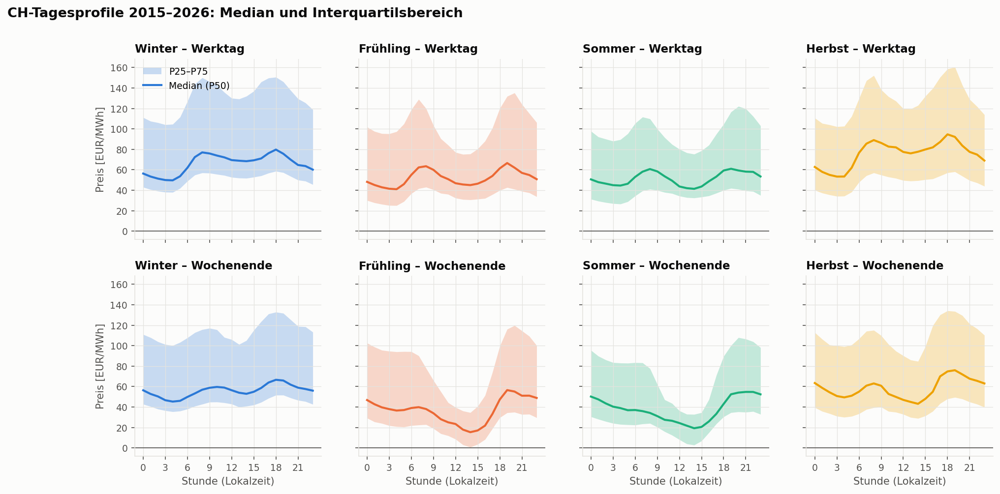
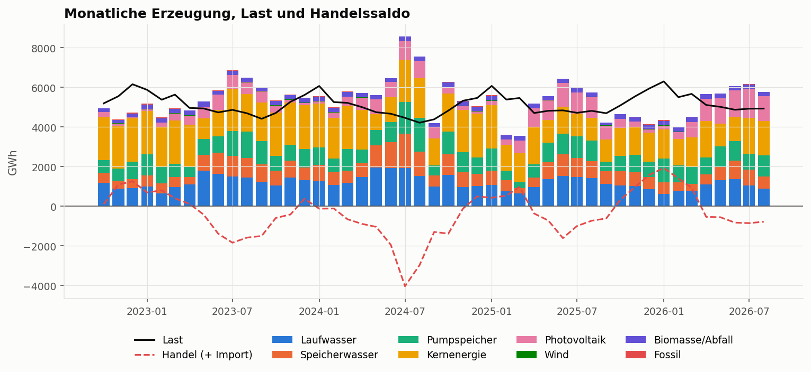
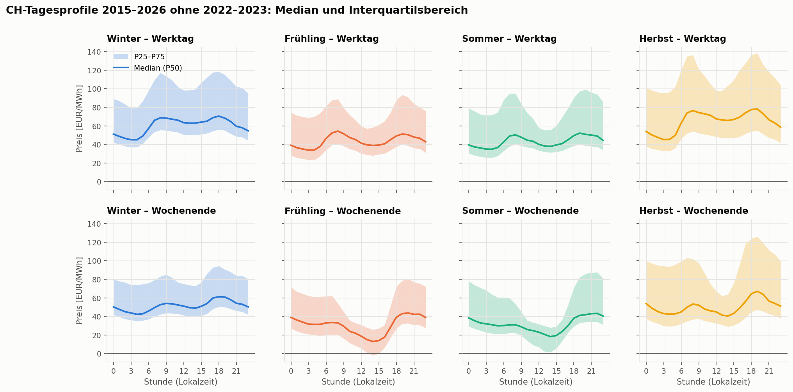
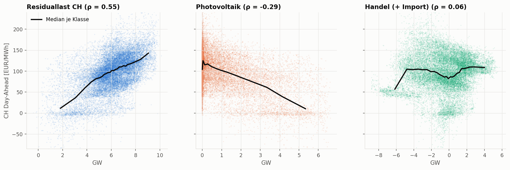
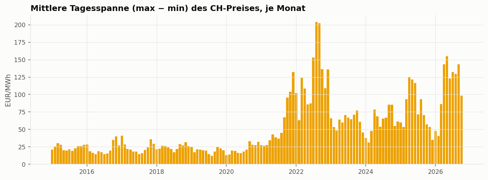
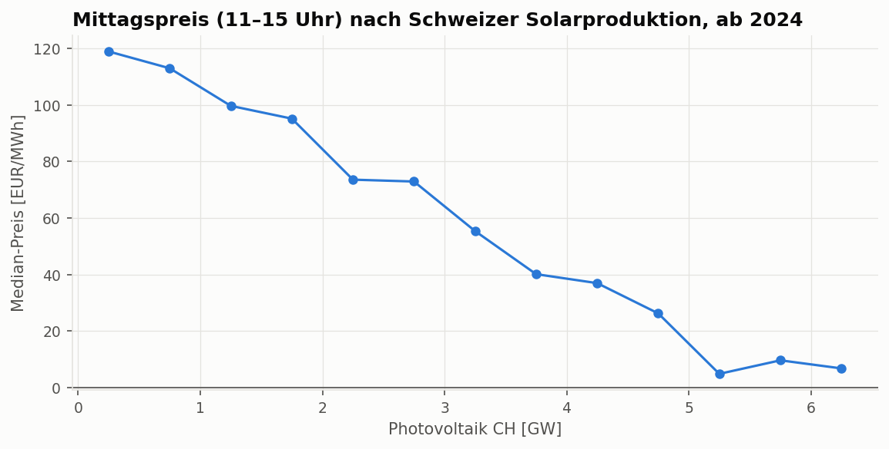

# Project Report

*The project will be structured using the CRISP-DM framework. Details about the framework can be found [here](https://www.datascience-pm.com/crisp-dm-2/). We will not conduct the deployment step. This page will serve as your project report. The current content provides a rough structure and helps you keep track of the deadlines for each deliverable. The first- and second-level headings should remain as provided in the template. All other content can be freely edited and adapted to your project.*

## Project Details

> 
### Team Members

| Name | Major task |
|--------|------------|
| Aaron Stupf |  Rechner   |
| Sebastian Lischer |  Analyse |

### Project Name

> Intelligent EMS
> 

### Pitch
Dynamic electricity tariffs are coming to Switzerland across most utilities, though they are currently only available in select regions like Zurich via EKZ. Our primary focus is analyzing European market factors to demystify these price swings and accurately simulate day-ahead prices 24 hours in advance. Building on this transparent analysis, an optional calculator demonstrates a practical use case: optimizing energy usage to save up to 0.15 CHF per 15-minute interval—roughly 500 CHF annually—while helping attract more people to solar power and driving overall sustainability.

---

# 1. Business Understanding

## Problem Statement

As Swiss utilities increasingly adopt dynamic 15-minute electricity tariffs, most households remain completely unaware of the underlying European market drivers causing price fluctuations and how to leverage them. Without transparent market analysis and predictive tooling, consumers miss out on significant cost savings and remain hesitant to invest in photovoltaic systems and home batteries.

## Goals

### 1. Core Market Analysis & 24h Price Simulation:
By the end of the semester, we aim to develop and validate a transparent analysis engine processing European day-ahead prices and generation data (via energy-charts.info) to explain price drivers. Success is measured by a normalized Mean Absolute Error (nMAE = MAE / mean absolute price) of under 10% for our 24-hour day-ahead price forecasts, evaluated on a holdout of at least 12 months (one full seasonal cycle). The 10% threshold follows from a volatility analysis of the Swiss day-ahead prices 2015–2026 ([analysis/06_zielwert.py](analysis/06_zielwert.py)). Over a year, a naive same-hour-last-week forecast reaches an nMAE of 14–25% (Ø 17.6%), depending on how strongly prices fluctuate. State-of-the-art models reduce this error to 38–68% of the naive one (relative MAE, rMAE; Lago et al., 2021). At average volatility, nMAE < 10% therefore corresponds to rMAE ≈ 0.57. We report the rMAE alongside the nMAE so that the result stays comparable across periods with different price volatility.

### 2. Optional Predictive Use-Case & Impact Calculator:
 Within the same timeframe, we will implement an optional model predictive control calculator to simulate household PV production and battery storage schedules. This will be measured by its ability to quantify concrete financial benefits—demonstrating savings of up to 0.15 CHF per 15-minute interval (roughly 500 CHF annually)—while successfully proving how such transparency incentivizes solar adoption and enhances ecological sustainability.

### 3. Documentation & Expert Validation:
We will finalize a comprehensive technical report and interactive demonstration by project completion, validating the usability and practical viability of our system through a dedicated presentation and review with the company Plan-E after the final discussion.

# 2. Data Understanding

## Data Sources

> ⚠️ **Deliverable - 12.11.2026:** Define data sources.

*You are free to choose any data source. As a starting point you might consider [Kaggle](https://www.kaggle.com/datasets) or Swiss open data platforms (e.g. Open Government Data [Zurich](https://www.stadt-zuerich.ch/de/politik-und-verwaltung/statistik-und-daten/open-government-data.html), [Luzern](https://www.stadtluzern.ch/opengovernmentdata), or [Switzerland](https://opendata.swiss/de)) as potential data sources.*

| Data source | Description |
|-------------|-------------|
| [Energy-Charts – Stromproduktion Schweiz (Pronovo)](https://www.energy-charts.info/charts/power/chart.htm?l=de&c=CH&source=pronovo&interval=year) | Fraunhofer ISE. Net electricity generation in Switzerland by source (hydro by category, nuclear, PV, wind, biomass, fossil), pumped-storage consumption, load and cross-border trade; 15-minute resolution in MW from 2020. Underlying sources according to Energy-Charts: Pronovo, ENTSO-E, SFOE (energetically corrected, published with a one-month delay). License CC BY 4.0. |
| [Energy-Charts – Börsenstrompreise und Handelsvolumen Schweiz](https://www.energy-charts.info/charts/price_volume/chart.htm?l=de&c=CH&interval=year) | Fraunhofer ISE. Swiss day-ahead auction: price (EUR/MWh) and traded volume (MWh) from 2014, hourly (also after the EU switch to 15-minute products on 01.10.2025). Underlying sources according to Energy-Charts: ENTSO-E, EPEX SPOT. License CC BY 4.0. |

## Exploratory Data Analysis

> ⚠️ **Deliverable - 12.11.2026:** Conduct an exploratory data analysis.

*A hands-on definition of EDA can be found [here](https://www.geeksforgeeks.org/data-analysis/what-is-exploratory-data-analysis/). The implementation of the EDA should be contained in a dedicated notebook.*

- Notebook to run the EDA: [01_data_understanding.ipynb](notebooks/01_data_understanding.ipynb)

The notebook downloads exactly the data behind the two Energy-Charts views (cached in `data/raw/energy_charts_web/`, not versioned). Data retrieved on 30.10.2026.

### Data Quality

**Day-ahead price and volume (2015 – 30.10.2026)**
- 103'704 hourly values, no gaps on the UTC time axis and no missing prices. All columns are numeric (`float64`).
- The Swiss series on Energy-Charts stays **hourly** even after the EU day-ahead auction switched to 15-minute products (01.10.2025). A forecast for a 15-minute tariff (EKZ) therefore applies per hour.
- Volume has exactly one missing value per year: 03:00 on the day of the switch to daylight saving time (an artefact of the source).
- 2015–2017 the file also contains the *IT-North-CH* auction; it is dropped.
- Extreme values are real market events, not errors (min −464 EUR/MWh in 2026, max 872 EUR/MWh in 2022), so they are kept.

**Electricity production, Pronovo (2020 – 31.08.2026)**
- 15-minute values without gaps, but published with a **one-month delay**. They can be used for analysis and training, not as a live input for the 24 h forecast.
- The **schema changes over time**: in 2020 hydro power is only reported as one total, nuclear and pumped-storage consumption are missing until 30.09.2022, and the biomass and fossil categories are renamed twice. The data set is complete and comparable only from **01.10.2022** onwards (year-to-year comparisons from 2023).
- **Load** is only hourly (every value repeated four times in the 15-minute grid), and so is most of the cross-border trade balance. Hydro, nuclear and pumped-storage values are genuine 15-minute values.

### Insights

1. **Structural breaks in the price level.** The annual mean was 34–52 EUR/MWh in 2015–2020, peaked at 282 EUR/MWh during the 2022 energy crisis (3'132 hours above 300 EUR/MWh) and is 131 EUR/MWh in 2026. A model must handle level shifts (e.g. predict the change versus the previous day instead of the absolute price), and 2021–2022 should not be used for training without care.
2. **Volatility is increasing, which is good for an EMS.** Negative prices rose from 9 hours (2015) to about 300 hours per year (2024/2025). The mean daily spread (max − min) grew from about 22 EUR/MWh (2015–2020) to 110 EUR/MWh (2026). The larger the spread, the more load shifting and batteries can save (Goal 2).
3. **Strong daily and seasonal pattern.** Over 2015–2026, working days show morning and evening peaks. On spring/summer weekends the median at 14:00 drops to 15–20 EUR/MWh and the 25th percentile is close to 0 (solar surplus). Without the crisis years 2022–2023 the shape stays the same, but the interquartile range becomes much narrower (winter: 75 → 46 EUR/MWh). Hour, weekday and season are therefore key features.
4. **Switzerland imports in winter.** It exports up to 4 TWh per month in summer and imports up to 2 TWh per month in winter, so the Swiss price is closely tied to neighbouring markets.
5. **Swiss production explains the price only partially.** The strongest Swiss driver is the residual load (load − PV − wind, Spearman ρ = 0.55); PV lowers the price (ρ = −0.29), and the midday price falls clearly with rising PV output. Pumped storage and reservoir hydro *react* to the price (pumping at low, generating at high prices) and are consequences rather than causes.
6. **PV is growing fast.** Its share of Swiss production rose from 7 % (2023) to 13 % (2025) and 18 % (Jan–Aug 2026), so midday price dips and negative prices will become more frequent.
7. **High autocorrelation, but naive forecasts are not enough.** The 24 h and 168 h lags correlate strongly with the price (r = 0.85 and 0.81 since 2024). Still, the naive same-hour-yesterday and same-hour-last-week forecasts only reach an nMAE of 13–21 % and 14–25 % per year. The goal nMAE < 10 % requires a model that reduces the persistence error by roughly 40 %.

**Is the data suitable?** The price series is complete, long and clean and is well suited as the target variable. The Pronovo data explains the Swiss side (generation mix, seasonality, solar effect) but, due to its one-month delay, cannot serve as a live input. For the 24 h forecast it is therefore complemented with day-ahead forecasts of solar, wind and load and with neighbouring prices (DE, FR, IT-North, AT), which are loaded by [analysis/01_fetch_data.py](analysis/01_fetch_data.py).

### Visualizations

The entire set of visualizations can be found in `figures/eda`.

| Price | Production and drivers |
|---|---|
|  |  |
|  |  |
|  |  |

- `01`–`06`: price over time, distribution, daily profiles (median and P25–P75, with and without 2022–2023), hour × month heatmap, daily spread, volume
- `07`–`09`: annual and monthly generation mix, daily generation profiles in summer and winter
- `10`–`13`: correlations with the price, scatter plots of the drivers, midday price vs. PV, autocorrelation

---

# 3. Data Preparation
*Data preparation (also known as feature engineering) consists of steps such as cleaning, filtering, joining, [aggregating](https://www.geeksforgeeks.org/python/grouping-and-aggregating-with-pandas/), [normalizing](https://www.geeksforgeeks.org/python/data-normalization-with-pandas/), and transforming the data. The goal is to have one dataset that contains all features and is ready to be used in the follow-up data modeling. All data preparation is contained in one notebook that may use modular code. Data preparation is not a deliverable but goes hand in hand with the follow-up step of data modeling.*

- Notebook to run the data preparation: [02_data_preparation.ipynb](notebooks/02_data_preparation.ipynb)
- Reusable, modular code is outsourced to separate `.py` files: [src/data_preparation.py](src/data_preparation.py)

## Features

*List and describe each feature.*

| Feature | Description |
|---------|-------------|
|         |             |
|         |             |
|         |             |

---

# 4. Data Modeling

> ⚠️ **Deliverable - 03.12.2026:** Summarize the data modeling approach.

## Concept
*Describe the data modeling approach in a few sentences. Which major tasks have to be performed? Which types of models are used (why)? What are the results? The goal of DSPRO1 is not to implement complex ML algorithms but to tell a coherent data story. A dashboard visualisation or a classical statistical analysis cab be sufficient in terms of data modeling.*

## Implementation
*Make a reference to the notebook and scripts used for performing the data modeling. Sketch a diagram that contains all major tasks and notes for the corresponding implementation.*

- Notebook to run the data modeling: [03_modeling.ipynb](notebooks/03_modeling.ipynb)
- Reusable, modular code is outsourced to separate `.py` files: [src/data_modeling.py](src/data_modeling.py)

# 5. Evaluation

> ⚠️ **Deliverable - 10.12.2026:** Discuss your results in the light of the project goals.

- Notebook to run the evaluation: [04_evaluation.ipynb](notebooks/04_evaluation.ipynb)

- All visualizations can be found in `figures/eval`.

## Results
*List major results. Results often come in the form of evaluation metrics.  A short introduction can be found [here](https://www.ibm.com/think/topics/model-evaluation).*

## Interpretation
*Interpret results in the light of the problem statement. Could you solve the problem? An important issue in the interpretation is practical applicability. Is your solution generalizable?*

## Limitations
*Describe weaknesses of your approach or the underlying data.*

---

# 6. Sustainable Development Goals

> ⚠️ **Deliverable - 17.12.2026:** Describe your results in the light of sustainability.

*The United Nations distinguishes 17 Sustainable Development Goals ([link](https://sdgs.un.org/goals)). Put the results of your project in relation to at least one of these goals. A four-sentence description is sufficient.*
