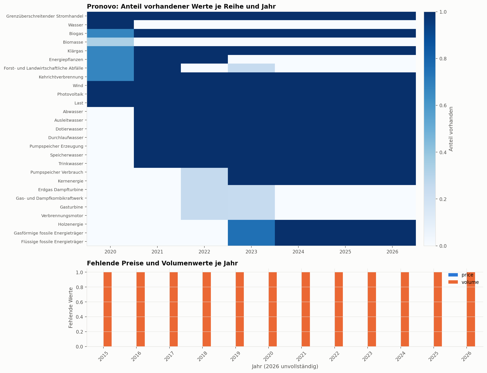
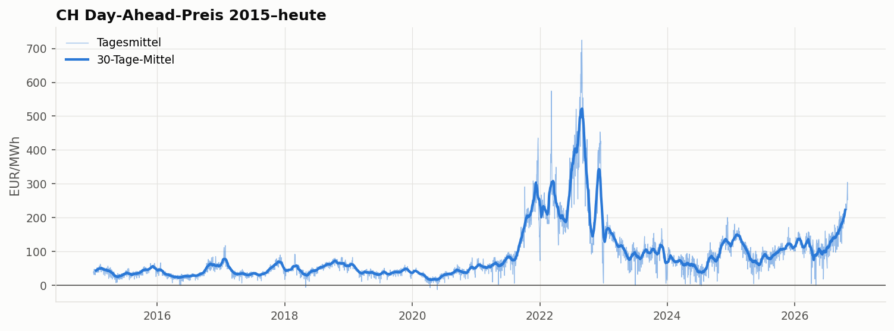
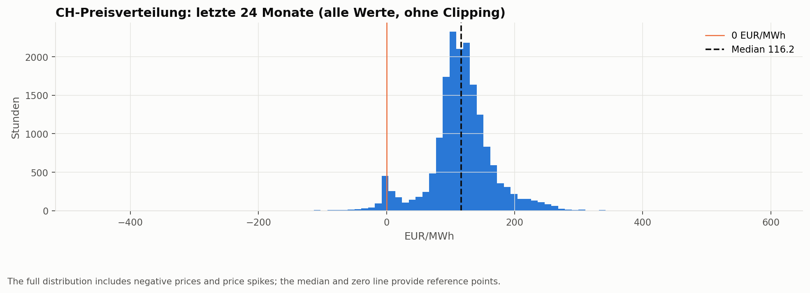
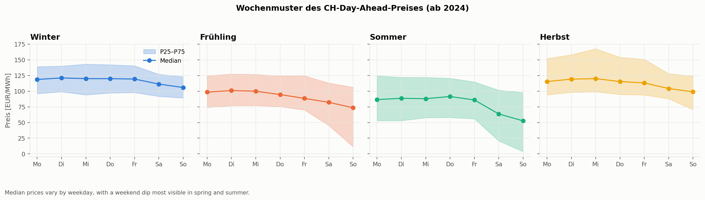
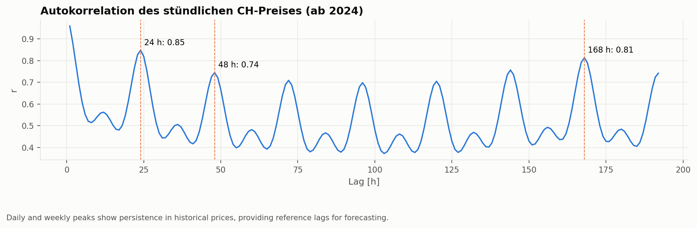
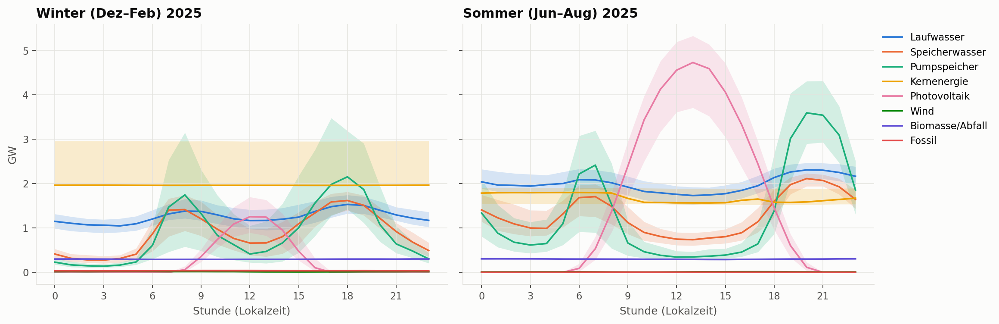
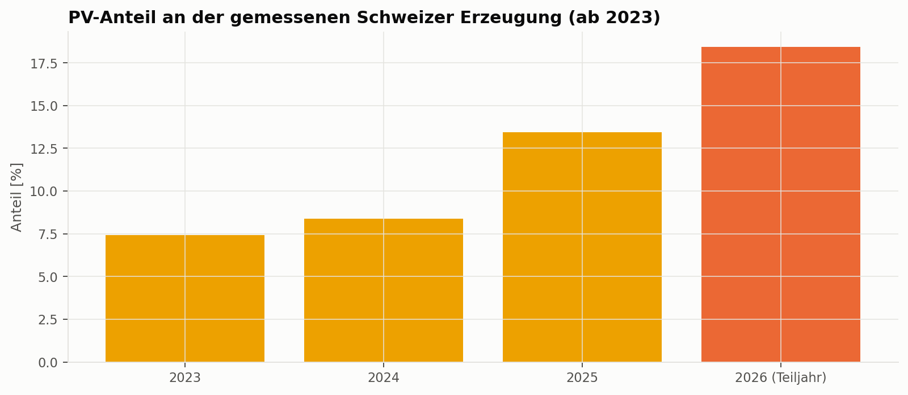
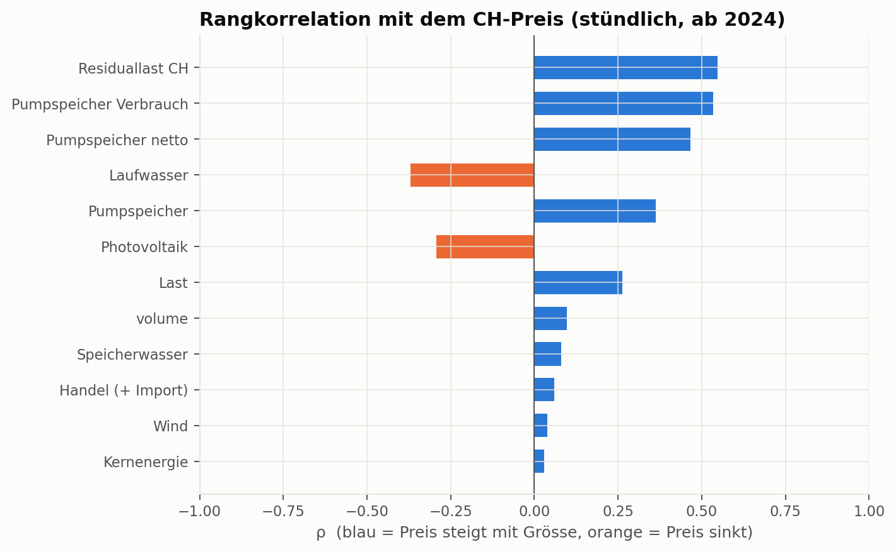
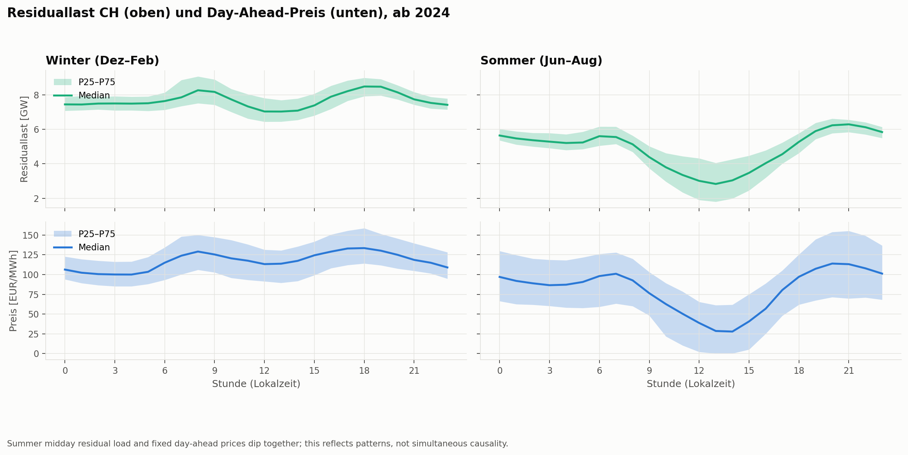
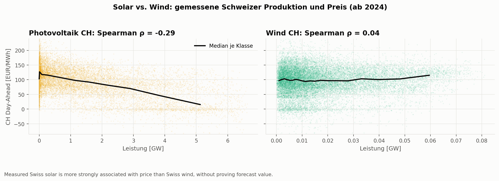

# Project Report

## Project Details

> 
### Team Members

| Name | Major task |
|--------|------------|
| Aaron Stupf |  Rechner   |
| Sebastian Lischer |  Analyse |

### Project Name

> Intelligent EMS
> 

### Pitch
Dynamic electricity tariffs are coming to Switzerland across most utilities, though they are currently only available in select regions like Zurich via EKZ. Our primary focus is analyzing European market factors to demystify these price swings and accurately simulate day-ahead prices 24 hours in advance. Building on this transparent analysis, an optional calculator demonstrates a practical use case: optimizing energy usage to save up to 0.15 CHF per 15-minute interval—roughly 500 CHF annually—while helping attract more people to solar power and driving overall sustainability.

---

# 1. Business Understanding

## Problem Statement

As Swiss utilities increasingly adopt dynamic 15-minute electricity tariffs, most households remain completely unaware of the underlying European market drivers causing price fluctuations and how to leverage them. Without transparent market analysis and predictive tooling, consumers miss out on significant cost savings and remain hesitant to invest in photovoltaic systems and home batteries.

## Goals

### 1. Core Market Analysis & 24h Price Simulation:
By the end of the semester, we aim to develop and validate a transparent analysis engine processing European day-ahead prices and generation data (via energy-charts.info) to explain price drivers. Success is measured by a normalized Mean Absolute Error (nMAE = MAE / mean absolute price) of under 10% for our 24-hour day-ahead price forecasts, evaluated on a holdout of at least 12 months (one full seasonal cycle). The 10% threshold follows from a volatility analysis of the Swiss day-ahead prices 2015–2026 ([analysis/06_zielwert.py](analysis/06_zielwert.py)). Over a year, a naive same-hour-last-week forecast reaches an nMAE of 14–25% (Ø 17.6%), depending on how strongly prices fluctuate. State-of-the-art models reduce this error to 38–68% of the naive one (relative MAE, rMAE; Lago et al., 2021). At average volatility, nMAE < 10% therefore corresponds to rMAE ≈ 0.57. We report the rMAE alongside the nMAE so that the result stays comparable across periods with different price volatility.

### 2. Optional Predictive Use-Case & Impact Calculator:
 Within the same timeframe, we will implement an optional model predictive control calculator to simulate household PV production and battery storage schedules. This will be measured by its ability to quantify concrete financial benefits—demonstrating savings of up to 0.15 CHF per 15-minute interval (roughly 500 CHF annually)—while successfully proving how such transparency incentivizes solar adoption and enhances ecological sustainability.

### 3. Documentation & Expert Validation:
We will finalize a comprehensive technical report and interactive demonstration by project completion, validating the usability and practical viability of our system through a dedicated presentation and review with the company Plan-E after the final discussion.

# 2. Data Understanding

## Data Sources

| Data source | Description |
|-------------|-------------|
| [Energy-Charts – Stromproduktion Schweiz (Pronovo)](https://www.energy-charts.info/charts/power/chart.htm?l=de&c=CH&source=pronovo&interval=year) | Fraunhofer ISE. Net electricity generation in Switzerland by source (hydro by category, nuclear, PV, wind, biomass, fossil), pumped-storage consumption, load and cross-border trade; 15-minute resolution in MW from 2020. Underlying sources according to Energy-Charts: Pronovo, ENTSO-E, SFOE (energetically corrected, published with a one-month delay). License CC BY 4.0. |
| [Energy-Charts – Börsenstrompreise und Handelsvolumen Schweiz](https://www.energy-charts.info/charts/price_volume/chart.htm?l=de&c=CH&interval=year) | Fraunhofer ISE. Swiss day-ahead auction: price (EUR/MWh) and traded volume (MWh) from 2014, hourly (also after the EU switch to 15-minute products on 01.10.2025). Underlying sources according to Energy-Charts: ENTSO-E, EPEX SPOT. License CC BY 4.0. |

As modelling starts, we will review and add further explanatory variables and data sources if needed; the model may require information beyond the sources listed here. Pronovo will be used retrospectively to identify candidate explanatory variables, not as a direct input to the prediction model. Any model inputs must come from sources available at the forecast issuance time.

## Exploratory Data Analysis

- Notebook to run the EDA: [01_data_understanding.ipynb](notebooks/01_data_understanding.ipynb)

The notebook downloads exactly the data behind the two Energy-Charts views (cached in `data/raw/energy_charts_web/`, not versioned). Data retrieved on 30.10.2026.

### Data Quality

**Day-ahead price and volume (2015 – 30.10.2026)**
- 103'704 hourly values, no gaps on the UTC time axis and no missing prices. All columns are numeric (`float64`).
- The Swiss series on Energy-Charts stays **hourly** even after the EU day-ahead auction switched to 15-minute products (01.10.2025). A forecast for a 15-minute tariff (EKZ) therefore applies per hour.
- Volume has exactly one missing value per year: 03:00 on the day of the switch to daylight saving time (an artefact of the source).
- 2015–2017 the file also contains the *IT-North-CH* auction; it is dropped.
- Extreme values are real market events, not errors (min −464 EUR/MWh in 2026, max 872 EUR/MWh in 2022), so they are kept.

**Electricity production, Pronovo (2020 – 31.08.2026)**
- 15-minute values without gaps, but published with a **one-month delay**. They are used for retrospective analysis to identify candidate explanatory variables, not as direct inputs to the prediction model.
- The **schema changes over time**: in 2020 hydro power is only reported as one total, nuclear and pumped-storage consumption are missing until 30.09.2022, and the biomass and fossil categories are renamed twice. The data set is complete and comparable only from **01.10.2022** onwards (year-to-year comparisons from 2023).
- **Load** is only hourly (every value repeated four times in the 15-minute grid), and so is most of the cross-border trade balance. Hydro, nuclear and pumped-storage values are genuine 15-minute values.

### Insights

**Data coverage limits which production comparisons are meaningful.** The figure shows the share of non-missing values by Pronovo series and year, alongside missing price/volume values. Structural schema gaps are not zero production; the comparable generation analysis begins on 01.10.2022.

The following relationships describe **already fixed day-ahead prices and subsequently measured production**, not real-time price setting. They are candidate signals for a future availability-aware forecasting study, not proof of predictive or causal performance. Price-only figures end on 30.10.2026; joint production/price figures end on 31.08.2026. Plot labels retain the notebook's German terminology; the English captions explain each chart.

#### Yearly price levels shift substantially over time

**Swiss day-ahead prices, 2015–30.10.2026.** Daily means and the 30-day mean highlight the 2022 price-regime break. Annual mean prices were **34.00–52.22 EUR/MWh in 2015–2020**, reached **281.65 in 2022**, and were **131.31 in Jan–Oct 2026** (partial year). The crisis year included **3'132 hours above 300 EUR/MWh**. These year-to-year changes are structural price-level shifts, not evidence of a repeating annual cycle. Evaluate models chronologically across regimes; the centered smoother is descriptive, not an available forecast feature.

**Hourly price distribution, last 24 months.** The untrimmed histogram includes **17'521 observations**, of which **542 hours had negative prices**. The full-series extremes were **−463.68 EUR/MWh (2026)** and **871.61 EUR/MWh (2022)**; the histogram window's maximum is **596.70 EUR/MWh**. These extreme prices are retained as market observations, not automatically treated as measurement errors.

#### Daily, weekly and seasonal patterns

**Seasonal daily profiles, 2015–2026.** Each line is the hourly **median**, and the shaded area is **P25–P75 (the middle 50%)**, not ±25% of the median or a confidence interval. Morning and evening peaks and a midday dip are consistent with expected demand and solar supply. The midday dip is especially clear on spring/summer weekends. Weekdays include holidays; the multi-year profiles mix price regimes, so not every weekday's minimum is at noon.

**Sensitivity to 2022–2023.** Removing these high-price years preserves the main shape while reducing the mean winter IQR width from **75.29 to 45.64 EUR/MWh**. Without these years, weekend median prices at 14:00 are **12.93 in spring** and **18.21 in summer**. Weekday minima in this longer historical sample are still overnight, so “midday is always cheapest” would overstate the evidence. This comparison tests robustness; it does not justify discarding crisis years from training automatically.

**Price by weekday and season, since 2024.** Seasonal median lines and P25–P75 bands show the weekend discount, most pronounced in spring and summer. Across all seasons, the median is **107.99 EUR/MWh on Tuesday**, **94.92 on Saturday** and **87.08 on Sunday**. These are descriptive pooled comparisons, not a controlled estimate of demand effects. Weekday, season and their interaction are therefore candidate features.

**Autocorrelation confirms daily and weekly repetition.** The hourly-price ACF since 2024 is **r = 0.847 at 24h**, **0.744 at 48h**, and **0.813 at 168h**, supporting the daily and weekly patterns above and motivating persistence baselines. In 2025, descriptive nMAE is **14.16% (24h)**, **19.29% (48h)** and **15.98% (168h)**; these are not issuance-aware D+2 backtest results. The ACF shown covers hourly lags only (up to 192h), so it does not test annual cycles; the notebook does not calculate PACF.

#### Intraday spreads create opportunities, but most first-day information is public

**Mean daily maximum-minus-minimum spread by month.** Annual mean daily spreads were **19.81–24.62 EUR/MWh in 2015–2020**, **61.61 in 2024**, **79.38 in 2025** and **110.47 in Jan–Oct 2026**. Negative-price hours increased from **9 in 2015** to **292 in 2024** and **303 in 2025**. This supports studying load shifting, not a guaranteed savings amount: the first delivery day's prices are already known, and battery constraints and retail tariffs reduce the usable margin. A second-day forecast must demonstrate **incremental** value over that known-price baseline.

#### Seasonal generation and trade motivate a regional market view

**Monthly production by source and the Swiss energy balance.** Individual producer lines make the mix readable without stacked areas. In the comparable period, monthly net trade ranges from **−4.04 TWh (export)** to **+1.93 TWh (import)**. Summer export and winter import patterns motivate including neighbouring markets; the balance alone does not establish their price effect.

**Production profiles in winter and summer 2025.** Each producer has its own median line and P25–P75 band. PV has a much stronger daytime peak in summer; controllable hydro and storage have different schedules. “Winter 2025” combines January, February and December of the same calendar year rather than one consecutive winter. These are observed production profiles, not forecasts available before the auction.

**PV share of Swiss generation.** The share rose from **7.41% in 2023** to **8.39% in 2024** and **13.43% in 2025**. **18.41% in Jan–Aug 2026** is a partial-year share with different seasonal coverage, not a directly comparable annual growth observation. The expansion motivates examining midday prices but does not by itself prove that future negative prices will become more frequent.

#### Residual load contains a strong retrospective price signal

**Rank correlations, since 2024.** Residual load (**load − PV − wind**) has **Spearman ρ = 0.548** with the price, compared with **0.262 for load alone**, **−0.292 for PV**, and **0.039 for Swiss wind**. This is the strongest absolute correlation among the Swiss variables examined, not an out-of-sample feature ranking. Pumped-storage consumption is signed negative: its positive ρ means less pumping at higher prices, consistent with dispatch responding to prices.

**Price against residual load, PV and trade.** The scatter plots use hourly observations; black curves are median prices in 25 equally populated bins. The residual-load gradient is clearer than the trade relationship (**ρ = 0.060**). For readability, scatter price axes show P0.2–P99.8; no corresponding observations are removed from the dataset or correlation calculation. Time of day, season, hydrology and regional market conditions remain confounders.

**Summer versus winter: residual load alongside prices.** On the joint period from 2024 to August 2026, the summer hourly median price falls to **27.83 EUR/MWh at 14:00**, compared with **113.92 at 20:00**; its profile range is **86.10 EUR/MWh**. The winter range is **33.49 EUR/MWh**, with higher breakfast/evening prices and a shallower midday dip. Residual load has a matching summer trough. This is consistent with the auction anticipating sunshine and demand; measured residual load did not change a price already fixed the day before. The separate axes have different units, and IQR bands are not forecast intervals.

#### Solar is a stronger Swiss proxy than wind, not yet a validated predictor

**Midday price by measured PV output, since 2024.** The median price generally decreases across 0.5-GW PV bins for 11:00–15:00 local time (at least 30 observations per bin). Restricting the hours reduces, but does not remove, time-of-day confounding. The result is consistent with expected next-day sunshine being priced in; it does not prove a simultaneous causal effect.

**Direct PV–wind comparison.** On the same joint period, PV's **ρ = −0.292** is substantially stronger in absolute terms than Swiss wind's **ρ = +0.039**. The black lines show binned median prices; the price axes use the same P0.2–P99.8 limits as the driver scatter. This supports investigating solar and residual-load forecasts, but does not show that wind forecasts are unhelpful in Germany or elsewhere. Stronger retrospective correlation alone is not a forecast-accuracy result.

#### Forecast timing defines the second-day benchmark

After the auction on day D, prices for D+1 are known. A target hour on D+2 has its 24h-lag on D+1, so that lag can already be available; 48h persistence is not the only permitted benchmark. Check publication times for each target hour, especially for rolling horizons and daylight-saving transitions. Delayed Pronovo data are retrospective candidates for identifying explanatory variables, not contemporaneous or lagged inputs to the prediction model. The existing [analysis pipeline](analysis/README.md) studies a pre-auction next-day task; its reported scores do **not** validate the proposed D+2 extension.

**Is the data suitable?** The complete price series is suitable as a target and supports clear temporal signals. Pronovo supports retrospective explanation after schema harmonization, but a deployable extended profile additionally needs archived, issuance-time-available D+2 forecasts and regional information. The next modeling step is to verify that availability and evaluate the second-day prediction separately, then compare scheduling against an EMS using only published prices. This EDA establishes relevant patterns and limitations, not a proven 48h forecasting product.

#### Summary / Conclusion

The price series shows substantial yearly regime shifts alongside daily and weekly patterns, with the strongest midday dips in summer. Swiss residual load and solar are useful retrospective explanatory candidates, while measured Swiss wind has a weaker association; these relationships are not causal findings or proof of D+2 forecast accuracy. Pronovo is used to identify candidate variables retrospectively, not as a direct input to the prediction model. Next, add further explanatory data as needed, verify that each source is available at forecast issuance, evaluate the D+2 block separately, and compare EMS scheduling with an approach using the published prices.

### Visualizations

The entire set of visualizations can be found in `figures/eda`.

---

# 3. Data Preparation

- Notebook to run the data preparation: [02_data_preparation.ipynb](notebooks/02_data_preparation.ipynb)
- Reusable, modular code is outsourced to separate `.py` files: [src/data_preparation.py](src/data_preparation.py)

## Features

---

# 4. Data Modeling

> ⚠️ **Deliverable - 03.12.2026:** Summarize the data modeling approach.

## Concept
*Describe the data modeling approach in a few sentences. Which major tasks have to be performed? Which types of models are used (why)? What are the results? The goal of DSPRO1 is not to implement complex ML algorithms but to tell a coherent data story. A dashboard visualisation or a classical statistical analysis cab be sufficient in terms of data modeling.*

## Implementation
*Make a reference to the notebook and scripts used for performing the data modeling. Sketch a diagram that contains all major tasks and notes for the corresponding implementation.*

- Notebook to run the data modeling: [03_modeling.ipynb](notebooks/03_modeling.ipynb)
- Reusable, modular code is outsourced to separate `.py` files: [src/data_modeling.py](src/data_modeling.py)

# 5. Evaluation

> ⚠️ **Deliverable - 10.12.2026:** Discuss your results in the light of the project goals.

- Notebook to run the evaluation: [04_evaluation.ipynb](notebooks/04_evaluation.ipynb)

- All visualizations can be found in `figures/eval`.

## Results
*List major results. Results often come in the form of evaluation metrics.  A short introduction can be found [here](https://www.ibm.com/think/topics/model-evaluation).*

## Interpretation
*Interpret results in the light of the problem statement. Could you solve the problem? An important issue in the interpretation is practical applicability. Is your solution generalizable?*

## Limitations
*Describe weaknesses of your approach or the underlying data.*

---

# 6. Sustainable Development Goals

> ⚠️ **Deliverable - 17.12.2026:** Describe your results in the light of sustainability.

*The United Nations distinguishes 17 Sustainable Development Goals ([link](https://sdgs.un.org/goals)). Put the results of your project in relation to at least one of these goals. A four-sentence description is sufficient.*
