# Project Report

## Project Details

> 
### Team Members

| Name | Major task |
|--------|------------|
| Aaron Stupf |  Calculator   |
| Sebastian Lischer |  Analysis |


### Project Name

> Intelligent EMS
> 

### Pitch
Dynamic electricity tariffs are coming to Switzerland across most utilities, though they are currently only available in select regions like Zurich via EKZ. Our primary focus is analyzing European market factors to demystify these price swings and accurately simulate day-ahead prices 24 hours in advance. Building on this transparent analysis, an optional calculator demonstrates a practical use case: optimizing energy usage to save up to 0.15 CHF per 15-minute interval—roughly 500 CHF annually—while helping attract more people to solar power and driving overall sustainability.

---

# 1. Business Understanding

## Problem Statement

As Swiss utilities increasingly adopt dynamic 15-minute electricity tariffs, most households remain completely unaware of the underlying European market drivers causing price fluctuations and how to leverage them. Without transparent market analysis and predictive tooling, consumers miss out on significant cost savings and remain hesitant to invest in photovoltaic systems and home batteries.

## Goals

### 1. Core Market Analysis & 24h Price Simulation:
By the end of the semester, we aim to develop and validate a transparent analysis engine processing European day-ahead prices and generation data (via energy-charts.info) to explain price drivers. Success is measured by a normalized Mean Absolute Error (nMAE = MAE / mean absolute price) of under 10% for our 24-hour day-ahead price forecasts, evaluated on a holdout of at least 12 months (one full seasonal cycle). The 10% threshold follows from a volatility analysis of the Swiss day-ahead prices 2015–2026 ([analysis/06_target_value.py](analysis/06_target_value.py)). Over a year, a naive same-hour-last-week forecast reaches an nMAE of 14–25% (avg. 17.6%), depending on how strongly prices fluctuate. State-of-the-art models reduce this error to 38–68% of the naive one (relative MAE, rMAE; Lago et al., 2021). At average volatility, nMAE < 10% therefore corresponds to rMAE ≈ 0.57. We report the rMAE alongside the nMAE so that the result stays comparable across periods with different price volatility.

### 2. Optional Predictive Use-Case & Impact Calculator:
 Within the same timeframe, we will implement an optional model predictive control calculator to simulate household PV production and battery storage schedules. This will be measured by its ability to quantify concrete financial benefits—demonstrating savings of up to 0.15 CHF per 15-minute interval (roughly 500 CHF annually)—while successfully proving how such transparency incentivizes solar adoption and enhances ecological sustainability.

### 3. Documentation & Expert Validation:
We will finalize a comprehensive technical report and interactive demonstration by project completion, validating the usability and practical viability of our system through a dedicated presentation and review with the company Plan-E after the final discussion.

# 2. Data Understanding

## Data Sources

| Data source | Description |
|-------------|-------------|
| [Energy-Charts – Electricity production Switzerland (Pronovo)](https://www.energy-charts.info/charts/power/chart.htm?l=en&c=CH&source=pronovo&interval=year) | Fraunhofer ISE. Net electricity generation in Switzerland by source (hydro by category, nuclear, PV, wind, biomass, fossil), pumped-storage consumption, load and cross-border trade; 15-minute resolution in MW from 2020. Underlying sources according to Energy-Charts: Pronovo, ENTSO-E, SFOE (energetically corrected, published with a one-month delay). License CC BY 4.0. |
| [Energy-Charts – Exchange electricity prices and trading volume Switzerland](https://www.energy-charts.info/charts/price_volume/chart.htm?l=en&c=CH&interval=year) | Fraunhofer ISE. Swiss day-ahead auction: price (EUR/MWh) and traded volume (MWh) from 2014, hourly (also after the EU switch to 15-minute products on 01.10.2025). Underlying sources according to Energy-Charts: ENTSO-E, EPEX SPOT. License CC BY 4.0. |

As modelling starts, we will review and add further explanatory variables and data sources if needed; the model may require information beyond the sources listed here. Pronovo will be used retrospectively to identify candidate explanatory variables, not as a direct input to the prediction model. Any model inputs must come from sources available at the forecast issuance time.

## Exploratory Data Analysis

- Notebook to run the EDA: [01_data_understanding.ipynb](notebooks/01_data_understanding.ipynb)

The notebook downloads exactly the data behind the two Energy-Charts views (cached in `data/raw/energy_charts_web/`, not versioned). Data retrieved on 30.10.2026.

### Data Quality

**Day-ahead price and volume (2015 – 30.10.2026)**
- 103'704 hourly values, no gaps on the UTC time axis and no missing prices. All columns are numeric (`float64`).
- The Swiss series on Energy-Charts stays **hourly** even after the EU day-ahead auction switched to 15-minute products (01.10.2025). A forecast for a 15-minute tariff (EKZ) therefore applies per hour.
- Volume has exactly one missing value per year: 03:00 on the day of the switch to daylight saving time (an artefact of the source).
- 2015–2017 the file also contains the *IT-North-CH* auction; it is dropped.
- Extreme values are real market events, not errors (min −464 EUR/MWh in 2026, max 872 EUR/MWh in 2022), so they are kept.

**Electricity production, Pronovo (2020 – 31.08.2026)**
- 15-minute values without gaps, but published with a **one-month delay**. They are used for retrospective analysis to identify candidate explanatory variables, not as direct inputs to the prediction model.
- The **schema changes over time**: in 2020 hydro power is only reported as one total, nuclear and pumped-storage consumption are missing until 30.09.2022, and the biomass and fossil categories are renamed twice. The data set is complete and comparable only from **01.10.2022** onwards (year-to-year comparisons from 2023).
- **Load** is only hourly (every value repeated four times in the 15-minute grid), and so is most of the cross-border trade balance. Hydro, nuclear and pumped-storage values are genuine 15-minute values.

### Insights

**Data coverage limits which production comparisons are meaningful.** The figure shows the share of non-missing values by Pronovo series and year, alongside missing price/volume values. Structural schema gaps are not zero production; the comparable generation analysis begins on 01.10.2022.

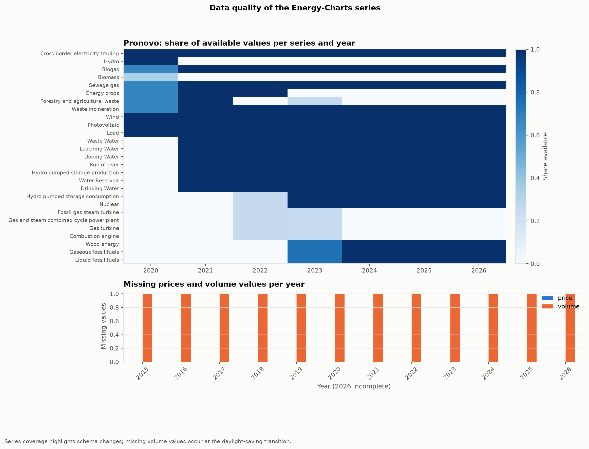


The following relationships describe **already fixed day-ahead prices and subsequently measured production**, not real-time price setting. They are candidate signals for a future availability-aware forecasting study, not proof of predictive or causal performance. Price-only figures end on 30.10.2026; joint production/price figures end on 31.08.2026.

#### Yearly price levels shift substantially over time

**Swiss day-ahead prices, 2015–30.10.2026.** Daily means and the 30-day mean highlight the 2022 price-regime break. Annual mean prices were **34.00–52.22 EUR/MWh in 2015–2020**, reached **281.65 in 2022**, and were **131.31 in Jan–Oct 2026** (partial year). The crisis year included **3'132 hours above 300 EUR/MWh**. These year-to-year changes are structural price-level shifts, not evidence of a repeating annual cycle. Evaluate models chronologically across regimes; the centered smoother is descriptive, not an available forecast feature.

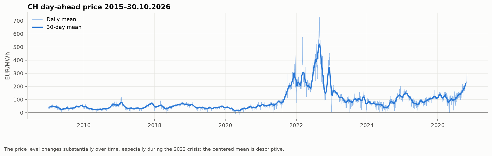

**Hourly price distribution, last 24 months.** The untrimmed histogram includes **17'521 observations**, of which **542 hours had negative prices**. The full-series extremes were **−463.68 EUR/MWh (2026)** and **871.61 EUR/MWh (2022)**; the histogram window's maximum is **596.70 EUR/MWh**. These extreme prices are retained as market observations, not automatically treated as measurement errors.

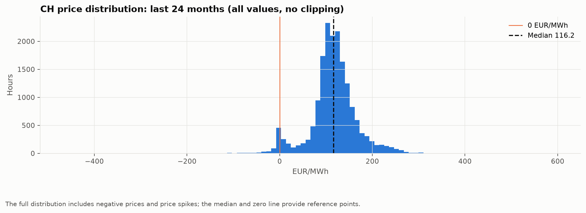

#### Daily, weekly and seasonal patterns

**Seasonal daily profiles, 2015–2026.** Each line is the hourly **median**, and the shaded area is **P25–P75 (the middle 50%)**, not ±25% of the median or a confidence interval. Morning and evening peaks and a midday dip are consistent with expected demand and solar supply. The midday dip is especially clear on spring/summer weekends. Weekdays include holidays; the multi-year profiles mix price regimes, so not every weekday's minimum is at noon.

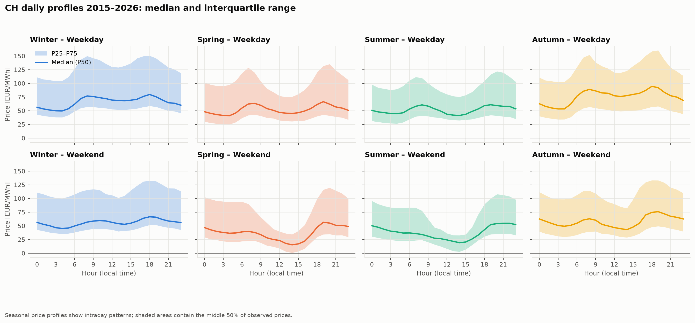

**Sensitivity to 2022–2023.** Removing these high-price years preserves the main shape while reducing the mean winter IQR width from **75.29 to 45.64 EUR/MWh**. Without these years, weekend median prices at 14:00 are **12.93 in spring** and **18.21 in summer**. Weekday minima in this longer historical sample are still overnight, so “midday is always cheapest” would overstate the evidence. This comparison tests robustness; it does not justify discarding crisis years from training automatically.

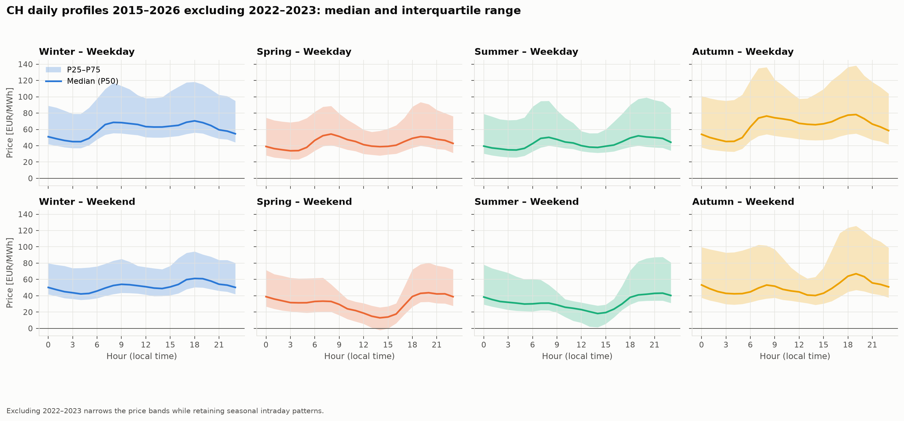

**Price by weekday and season, since 2024.** Seasonal median lines and P25–P75 bands show the weekend discount, most pronounced in spring and summer. Across all seasons, the median is **107.99 EUR/MWh on Tuesday**, **94.92 on Saturday** and **87.08 on Sunday**. These are descriptive pooled comparisons, not a controlled estimate of demand effects. Weekday, season and their interaction are therefore candidate features.

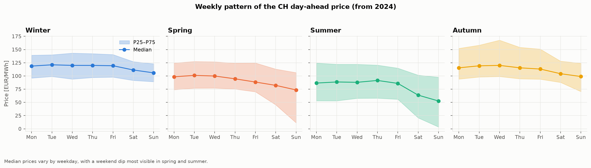

**Autocorrelation confirms daily and weekly repetition.** The hourly-price ACF since 2024 is **r = 0.847 at 24h**, **0.744 at 48h**, and **0.813 at 168h**, supporting the daily and weekly patterns above and motivating persistence baselines. In 2025, descriptive nMAE is **14.16% (24h)**, **19.29% (48h)** and **15.98% (168h)**; these are not issuance-aware D+2 backtest results. The ACF shown covers hourly lags only (up to 192h), so it does not test annual cycles; the notebook does not calculate PACF.

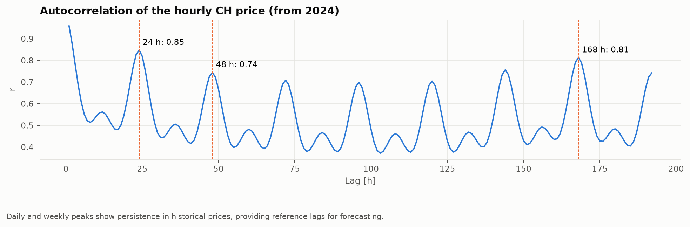

#### Intraday spreads create opportunities, but most first-day information is public

**Mean daily maximum-minus-minimum spread by month.** Annual mean daily spreads were **19.81–24.62 EUR/MWh in 2015–2020**, **61.61 in 2024**, **79.38 in 2025** and **110.47 in Jan–Oct 2026**. Negative-price hours increased from **9 in 2015** to **292 in 2024** and **303 in 2025**. This supports studying load shifting, not a guaranteed savings amount: the first delivery day's prices are already known, and battery constraints and retail tariffs reduce the usable margin. A second-day forecast must demonstrate **incremental** value over that known-price baseline.

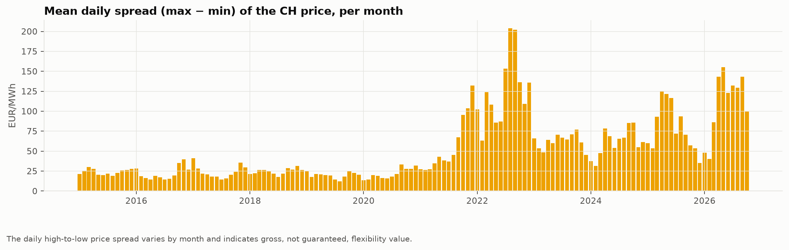

#### Seasonal generation and trade motivate a regional market view

**Monthly production by source and the Swiss energy balance.** Individual producer lines make the mix readable without stacked areas. In the comparable period, monthly net trade ranges from **−4.04 TWh (export)** to **+1.93 TWh (import)**. Summer export and winter import patterns motivate including neighbouring markets; the balance alone does not establish their price effect.

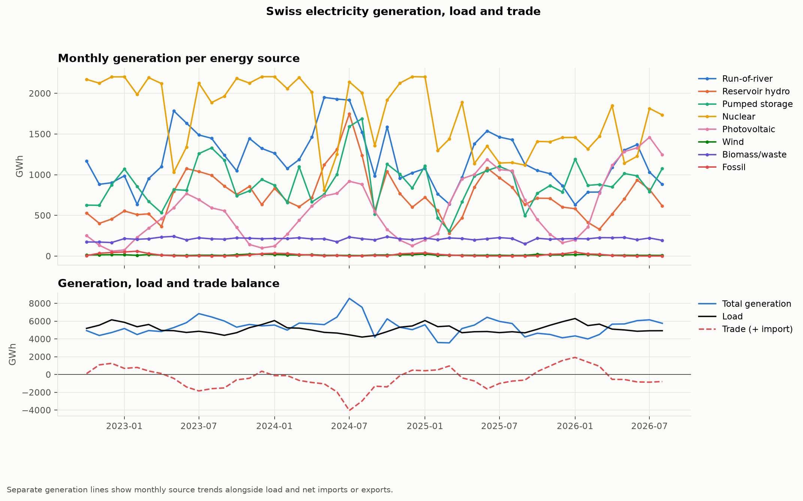

**Production profiles in winter and summer 2025.** Each producer has its own median line and P25–P75 band. PV has a much stronger daytime peak in summer; controllable hydro and storage have different schedules. “Winter 2025” combines January, February and December of the same calendar year rather than one consecutive winter. These are observed production profiles, not forecasts available before the auction.

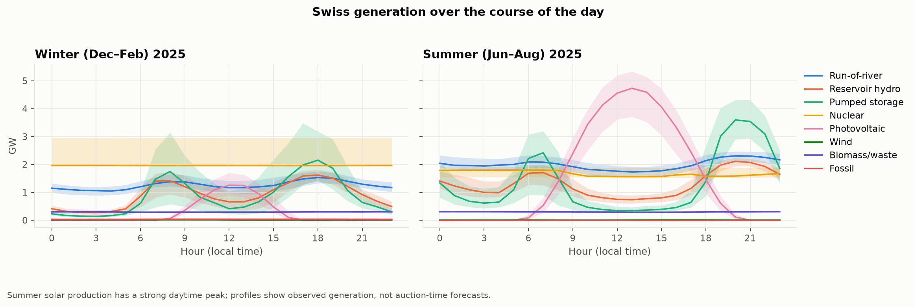

**PV share of Swiss generation.** The share rose from **7.41% in 2023** to **8.39% in 2024** and **13.43% in 2025**. **18.41% in Jan–Aug 2026** is a partial-year share with different seasonal coverage, not a directly comparable annual growth observation. The expansion motivates examining midday prices but does not by itself prove that future negative prices will become more frequent.

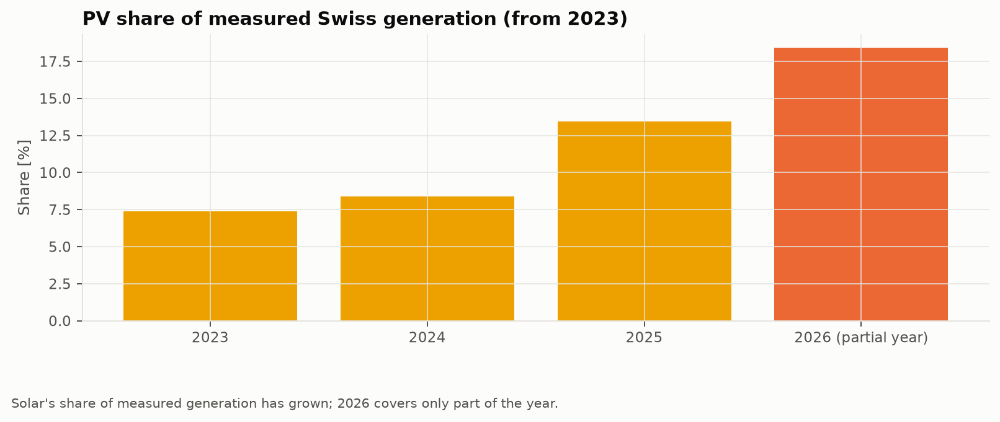

#### Residual load contains a strong retrospective price signal

**Rank correlations, since 2024.** Residual load (**load − PV − wind**) has **Spearman ρ = 0.548** with the price, compared with **0.262 for load alone**, **−0.292 for PV**, and **0.039 for Swiss wind**. This is the strongest absolute correlation among the Swiss variables examined, not an out-of-sample feature ranking. Pumped-storage consumption is signed negative: its positive ρ means less pumping at higher prices, consistent with dispatch responding to prices.

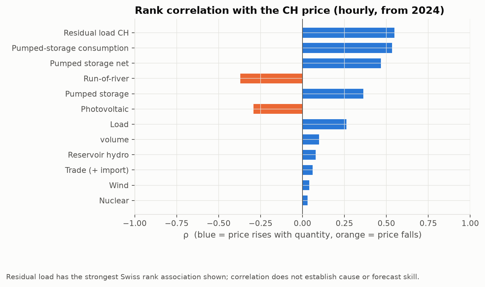

**Price against residual load, PV and trade.** The scatter plots use hourly observations; black curves are median prices in 25 equally populated bins. The residual-load gradient is clearer than the trade relationship (**ρ = 0.060**). For readability, scatter price axes show P0.2–P99.8; no corresponding observations are removed from the dataset or correlation calculation. Time of day, season, hydrology and regional market conditions remain confounders.

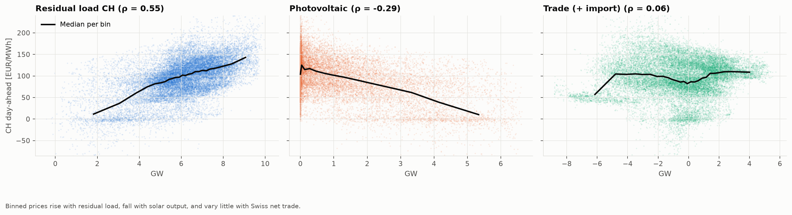

**Summer versus winter: residual load alongside prices.** On the joint period from 2024 to August 2026, the summer hourly median price falls to **27.83 EUR/MWh at 14:00**, compared with **113.92 at 20:00**; its profile range is **86.10 EUR/MWh**. The winter range is **33.49 EUR/MWh**, with higher breakfast/evening prices and a shallower midday dip. Residual load has a matching summer trough. This is consistent with the auction anticipating sunshine and demand; measured residual load did not change a price already fixed the day before. The separate axes have different units, and IQR bands are not forecast intervals.

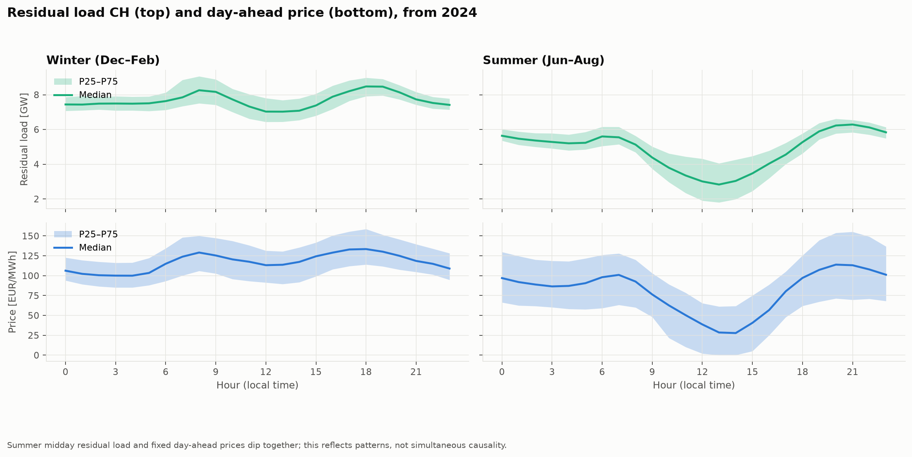

#### Solar is a stronger Swiss proxy than wind, not yet a validated predictor

**Midday price by measured PV output, since 2024.** The median price generally decreases across 0.5-GW PV bins for 11:00–15:00 local time (at least 30 observations per bin). Restricting the hours reduces, but does not remove, time-of-day confounding. The result is consistent with expected next-day sunshine being priced in; it does not prove a simultaneous causal effect.

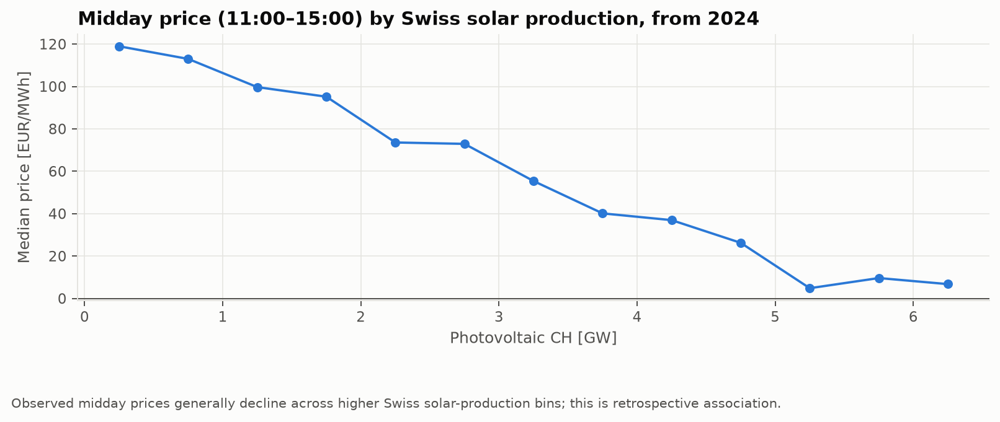

**Direct PV–wind comparison.** On the same joint period, PV's **ρ = −0.292** is substantially stronger in absolute terms than Swiss wind's **ρ = +0.039**. The black lines show binned median prices; the price axes use the same P0.2–P99.8 limits as the driver scatter. This supports investigating solar and residual-load forecasts, but does not show that wind forecasts are unhelpful in Germany or elsewhere. Stronger retrospective correlation alone is not a forecast-accuracy result.

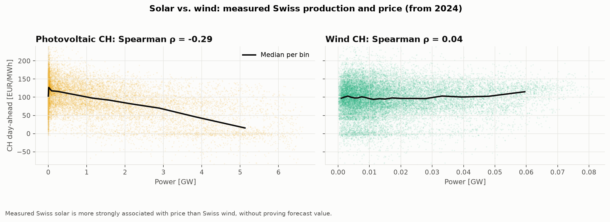

#### Forecast timing defines the second-day benchmark

After the auction on day D, prices for D+1 are known. A target hour on D+2 has its 24h-lag on D+1, so that lag can already be available; 48h persistence is not the only permitted benchmark. Check publication times for each target hour, especially for rolling horizons and daylight-saving transitions. Delayed Pronovo data are retrospective candidates for identifying explanatory variables, not contemporaneous or lagged inputs to the prediction model. The existing [analysis pipeline](analysis/README.md) studies a pre-auction next-day task; its reported scores do **not** validate the proposed D+2 extension.

**Is the data suitable?** The complete price series is suitable as a target and supports clear temporal signals. Pronovo supports retrospective explanation after schema harmonization, but a deployable extended profile additionally needs archived, issuance-time-available D+2 forecasts and regional information. The next modeling step is to verify that availability and evaluate the second-day prediction separately, then compare scheduling against an EMS using only published prices. This EDA establishes relevant patterns and limitations, not a proven 48h forecasting product.

#### Summary / Conclusion

The price series shows substantial yearly regime shifts alongside daily and weekly patterns, with the strongest midday dips in summer. Swiss residual load and solar are useful retrospective explanatory candidates, while measured Swiss wind has a weaker association; these relationships are not causal findings or proof of D+2 forecast accuracy. Pronovo is used to identify candidate variables retrospectively, not as a direct input to the prediction model. Next, add further explanatory data as needed, verify that each source is available at forecast issuance, evaluate the D+2 block separately, and compare EMS scheduling with an approach using the published prices.

### Visualizations

The entire set of visualizations can be found in `figures/eda`.

---

# 3. Data Preparation

- Notebook to run the data preparation: [02_data_preparation.ipynb](notebooks/02_data_preparation.ipynb)
- Reusable, modular code is outsourced to separate `.py` files: [src/data_preparation.py](src/data_preparation.py)

The data set is **hourly from 2024**. All sources are downloaded on the first run and cached under `data/raw/` (not versioned); if the hourly base file from `analysis/01_fetch_data.py` is missing, `load_hourly()` starts that download itself (~30 min, the Energy-Charts API throttles requests).

| Source | Content | Resolution |
|---|---|---|
| Energy-Charts API (via `analysis/01_fetch_data.py`) | Day-ahead prices CH, DE, FR, IT-North, AT; actual generation and load; cross-border trade; TSO forecasts (comparison only) | hourly |
| [Open-Meteo Previous Runs API](https://open-meteo.com/en/docs/previous-runs-api) | Weather forecasts as issued 2 and 3 days before the target hour, for 35 points in CH, DE, FR, IT and AT (temperature, radiation, cloud cover, wind at 100 m, precipitation) | hourly, from 18.02.2024 |
| [Energy-Charts – Filling level of storage lakes](https://www.energy-charts.info/charts/filling_level/chart.htm?l=en&c=CH) | Swiss reservoir filling level (SFOE), TWh per region | weekly, from 2000 |
| [Energy-Charts – Spot market prices](https://www.energy-charts.info/charts/price_spot_market/chart.htm?l=en&c=DE) | Gas (THE) and CO₂ prices and the marginal cost of a gas plant (2 × gas + 0.4 × CO₂) | daily |

**Why the period was shortened from 2015 to 2024.** Prices are available from 2015 (Section 2), but a model only learns well from a period that resembles the situation it will forecast. Neither earlier phase does:

| Period | Mean price | Spread (std) | Lowest / highest price | Negative hours per year | Suitable for training? |
|---|---|---|---|---|---|
| 2015–2020 | 34–52 EUR/MWh | 12–20 | −60 / 180 EUR/MWh | 5–75 | no: too calm |
| 2021–2023 | 107–282 EUR/MWh | 40–128 | −143 / 872 EUR/MWh | 1–76 | no: crisis |
| 2024–2025 | 76–102 EUR/MWh | 39–41 | −428 / 318 EUR/MWh | ~300 | yes |

- **2015–2020 is too calm.** Prices were low and stable, with hardly any negative hours. Since then, solar has grown strongly: negative prices now occur in around 300 hours a year, and the midday dips in summer are much deeper. A model trained on these years would learn a market that no longer exists and would underestimate today's swings.
- **2021–2023 is too extreme.** The energy crisis (gas shortage, French nuclear outages) drove the average to 282 EUR/MWh in 2022, with spikes up to 872 EUR/MWh. These prices were driven by an exceptional situation, not by the weather and demand patterns we want to learn. They would dominate the training and pull every forecast upwards.
- **From 2024** the market has settled at a new normal: a moderate price level with many negative hours and strong solar effects. This is the regime the model will forecast. The Pronovo schema has also been comparable only since October 2022 (Section 2), and archived weather forecasts for D+2 only exist from 2024.

The price is still not stable within this period (the level rises from 2024 to 2026), which is why the model predicts the change against the previous day rather than the price level (see *Target* below).

**What is new compared with the EDA.** The EDA (Section 2) worked with two sources only: the Swiss day-ahead price and the Pronovo generation data. Pronovo is published with a one-month delay and can therefore only explain prices in hindsight. For a forecast we need inputs that exist on the day the forecast is issued, so the preparation replaces and extends the EDA data:

| | EDA (`01_data_understanding`) | Data preparation (`02_data_preparation`) |
|---|---|---|
| Period | prices from 2015, generation from 2020 | hourly from 2024 (December 2023 as lead-in for the lags) |
| Prices | Switzerland | Switzerland and the four neighbours DE, FR, IT-North, AT |
| Generation and load | Pronovo, Switzerland, one-month delay | ENTSO-E actuals for five countries, available within hours (used with a 72 h lag) |
| Weather ahead | measured weather (descriptive) | archived **weather forecasts for D+2** for five countries (see below) |
| Hydro | hydro generation (Pronovo) | **reservoir filling level** and its deviation from a normal year |
| Fuels | — | **gas and CO₂ price**, marginal cost of a gas plant |
| Calendar | hour, weekday, season (descriptive) | hour, month (as sine/cosine), weekend, Swiss and German holidays |

**Result.** The notebook collects everything in one table, the variable **`candidates`**: one row per hour (index in UTC), the 46 candidate predictors and the two targets (price and price change against the previous day). It is saved as **`data/processed/candidates_d2.csv`** (24,648 hours × 48 columns) and is the input for the modelling in `03_modeling.ipynb`, so the downloads do not have to be repeated. Like all data it lies under `data/` and is not versioned; running the notebook recreates it.

**The two new sources at a glance.**
- **Why this figure:** The reservoir level and the gas and CO₂ prices are new compared with the EDA. Before they become candidates, we check whether they look plausible and in which form they belong in the model.
- **What we want to analyse:**
  - Left: does the reservoir level follow the same curve every year? If so, the level itself carries little information, only its **deviation from the usual level** of the same week.
  - Right: does the Swiss price follow the cost of a gas plant, as the merit order suggests (the most expensive plant still needed sets the price)?

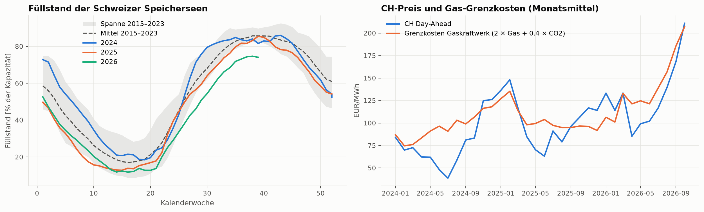

- **What we see:** The reservoir level follows the same curve every year: it is drawn down in winter and refilled by the snowmelt, with its low in April and its high in September. In early 2024 the lakes were about 10 percentage points fuller than usual and prices were low (76 EUR/MWh on average in 2024). From 2025 they were 3–12 points emptier than usual while prices rose (102 EUR/MWh in 2025, 128 EUR/MWh in 2026). This deviation becomes the candidate **reservoir level anomaly**. The marginal cost of a gas plant runs parallel to the Swiss monthly price, because gas plants in the neighbouring countries set the price in many hours. It explains the price **level** over months, not the swings within a day.

## Features

### Forecast situation: why we use weather forecasts for D+2

**The situation.** The Swiss day-ahead auction takes place every day around 12:00 for the following day. After the auction on day **D**, the 24 prices of **D+1** are known. Our model adds the **second day D+2**, so that an energy management system can plan 48 hours ahead (24 h known + 24 h forecast). Every feature must therefore contain only what is known on day D at 12:00. Prices are used with a lag of at least 24 h, actual generation with 72 h, gas and CO₂ with the value of day D, and the reservoir level with a delay of 7 days.

**The problem.** Solar, wind and load are among the most important price drivers (residual load, Section 2). Transmission system operators (TSOs) publish forecasts for them, but only for the *next* day:

```
Day D,   ~12:00   auction → prices for D+1 known → we forecast D+2
Day D+1, ~18:00   TSO forecast for D+2 is published   ← too late for us
```

A model trained with these TSO forecasts would use information from the future. It would look better in the test than it could ever be in operation.

**The solution: the weather forecast goes into the model directly.** Weather forecasts reach 7–16 days ahead, so they exist on day D for D+2. For each country (CH, DE, FR, IT, AT) we take the forecast temperature, solar radiation and wind speed at 100 m (hub height), averaged over several points. The price model learns by itself that, for example, strong wind in northern Germany lowers the price.

**Why archived forecasts and not measured weather?** For training we need the forecasts *as they were issued at the time*, including their errors. With measured weather, the model would know the weather of D+2 perfectly during training. It would rely on it too much and look better in the test than in operation, where only a forecast is available, and wind two days ahead can be quite wrong. A normal weather API only returns the current forecast. Open-Meteo, however, archives past model runs ("previous runs"), from 20.01.2024 (wind at 100 m from 18.02.2024). We download them for 35 points in CH, DE, FR, IT and AT. For each hour of D+2 we take the run that was already published at 12:00 on day D: for the early hours the run from two days before, otherwise the run from three days before.

**Does the weather forecast describe the production?**
- **Why this figure:** The weather forecast replaces the TSO's production forecast. We check how well it matches the actual production, using German wind, the largest single driver of price swings.
- **What we want to analyse:** Does the production rise with the forecast wind speed, and how wide is the spread? Does the forecast for D+2 follow the large swings of a week?

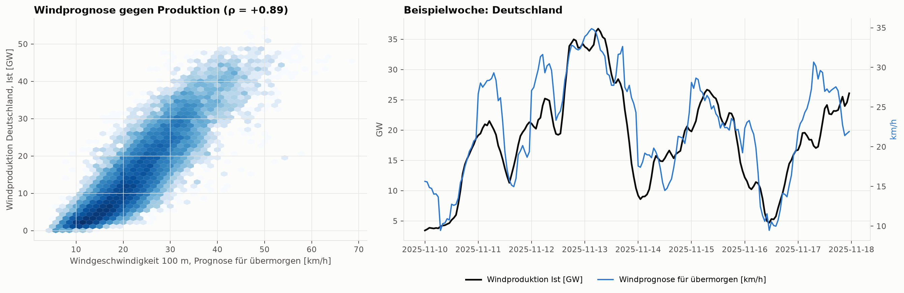

- **What we see:** The production rises clearly with the forecast wind speed (ρ +0.89). Below about 10 km/h it stays close to zero, above that it rises almost evenly. The spread is wide: the same wind speed leads to different production, because of forecast errors two days ahead, curtailment and new turbines over time. In the example week the forecast follows the large changes between windy and calm days, and these changes are what moves the price. The weather forecast therefore carries most of the information a production forecast in MW would have.

**Direct comparison.** A first XGBoost model (training 18.02.2024–30.09.2025, test from 01.10.2025, otherwise the same predictors; see *Target* below) shows what the weather forecast is worth (figure in Section 4):

| Variant | Available on day D? | nMAE in test |
|---|---|---|
| Naive: price of the previous day | yes | 14.4 % |
| **Without** forecasts for D+2 | yes | 13.3 % |
| **With the weather forecast** (selected: temperature CH, radiation CH, wind DE) | yes | **11.8 %** |
| With the weather forecast of all countries (all 15 series) | yes | 11.5 % |
| With the TSO forecast, i.e. pretending D+1 were D+2 | **no** | 11.2 % |

Even without any forecast for D+2 the model beats the naive forecast (13.3 % vs 14.4 %). The weather forecast lowers the error to **11.8 %**, which recovers most of the gain the TSO forecast would bring. With all 15 weather series the error drops slightly further (11.5 %); `03_modeling` checks which additional series are worth it (for example French wind). Pretending that the TSO forecast for D+1 were already known for D+2 gives 11.2 %. That number would be too optimistic and could not be reached in operation.

### Target: the change against the previous day

The model does not predict the price level directly, but its **change against the previous day** (price − CH lag 24 h); the forecast is yesterday's price plus the predicted change. The price level rises during the test period (about 128 EUR/MWh in 2026) above almost all training values. Tree models cannot extrapolate beyond the range they were trained on and would systematically forecast too low. A change, however, stays in a similar range across years.

For the same reason, the weather forecasts are also used as **change features** (Δ = value for D+2 minus value 24 h earlier). *More wind than yesterday* explains a falling price better than *a lot of wind*. This approach already brought the error of the existing D+1 pipeline in `analysis/` below 10 %.

### Overview of all 46 candidate predictors

*Type* states which values a predictor takes, and *available as* states the delay with which it is known at 12:00 on day D:
- **continuous:** any number with a unit;
- **binary:** only 0 or 1;
- **cyclic:** sine or cosine between −1 and 1;
- **percent / percentage points:** a share, or a deviation from that share.

**Why sine and cosine?** As a plain number from 0 to 23, 23:00 and 00:00 would be far apart although they are neighbours. Placed on a circle, with sine and cosine together, they lie next to each other. The same holds for December and January.

| # | Predictor (column in the CSV) | Type | Unit | Meaning | Available as | Decision |
|---|---|---|---|---|---|---|
| 1 | `CH Lag 24h` | continuous | EUR/MWh | Swiss price in the same hour on the previous day (D+1, already known) | lag 24 h | **keep** |
| 2 | `CH Lag 48h` | continuous | EUR/MWh | Swiss price in the same hour two days earlier | lag 48 h | drop |
| 3 | `CH Lag 168h` | continuous | EUR/MWh | Swiss price in the same hour one week earlier (same weekday) | lag 168 h | **keep** |
| 4 | `CH Mittel Vortag` | continuous | EUR/MWh | daily mean of the Swiss price on the previous day | day D+1 | drop |
| 5 | `CH Mittel 7 Tage` | continuous | EUR/MWh | mean of the last 7 daily means: current price level | up to D+1 | **keep** |
| 6 | `DE Lag 24h` | continuous | EUR/MWh | German/Luxembourg price, same hour, previous day | lag 24 h | test in model |
| 7 | `FR Lag 24h` | continuous | EUR/MWh | French price, same hour, previous day | lag 24 h | test in model |
| 8 | `IT-Nord Lag 24h` | continuous | EUR/MWh | North Italian price, same hour, previous day | lag 24 h | drop |
| 9 | `AT Lag 24h` | continuous | EUR/MWh | Austrian price, same hour, previous day | lag 24 h | drop |
| 10 | `DE gleichzeitig*` | continuous | EUR/MWh | German price in the same hour (comparison only) | not available | not available |
| 11 | `FR gleichzeitig*` | continuous | EUR/MWh | French price in the same hour (comparison only) | not available | not available |
| 12 | `IT-Nord gleichzeitig*` | continuous | EUR/MWh | North Italian price in the same hour (comparison only) | not available | not available |
| 13 | `AT gleichzeitig*` | continuous | EUR/MWh | Austrian price in the same hour (comparison only) | not available | not available |
| 14 | `Temperatur CH (D+2)` | continuous | °C | forecast air temperature for D+2, mean of 5 Swiss cities (drives consumption: heating, cooling) | forecast of day D | **keep** |
| 15 | `Einstrahlung CH (D+2)` | continuous | W/m² | forecast solar radiation for D+2, mean of 5 Swiss cities (drives solar production) | forecast of day D | **keep** |
| 16 | `Wind 100m CH (D+2)` | continuous | km/h | forecast wind speed at 100 m (hub height), mean of 5 Swiss points | forecast of day D | drop |
| 17 | `Temperatur DE (D+2)` | continuous | °C | forecast air temperature Germany, mean of 9 points | forecast of day D | drop |
| 18 | `Einstrahlung DE (D+2)` | continuous | W/m² | forecast solar radiation Germany, mean of 9 points | forecast of day D | drop |
| 19 | `Wind 100m DE (D+2)` | continuous | km/h | forecast wind speed at 100 m Germany, mean of 9 points (incl. North Sea) | forecast of day D | **keep** |
| 20 | `Temperatur FR (D+2)` | continuous | °C | forecast air temperature France, mean of 8 points | forecast of day D | drop |
| 21 | `Einstrahlung FR (D+2)` | continuous | W/m² | forecast solar radiation France, mean of 8 points | forecast of day D | drop |
| 22 | `Wind 100m FR (D+2)` | continuous | km/h | forecast wind speed at 100 m France, mean of 8 points | forecast of day D | test in model |
| 23 | `Temperatur IT (D+2)` | continuous | °C | forecast air temperature Italy, mean of 8 points | forecast of day D | drop |
| 24 | `Einstrahlung IT (D+2)` | continuous | W/m² | forecast solar radiation Italy, mean of 8 points | forecast of day D | drop |
| 25 | `Wind 100m IT (D+2)` | continuous | km/h | forecast wind speed at 100 m Italy, mean of 8 points | forecast of day D | drop |
| 26 | `Temperatur AT (D+2)` | continuous | °C | forecast air temperature Austria, mean of 5 points | forecast of day D | drop |
| 27 | `Einstrahlung AT (D+2)` | continuous | W/m² | forecast solar radiation Austria, mean of 5 points | forecast of day D | drop |
| 28 | `Wind 100m AT (D+2)` | continuous | km/h | forecast wind speed at 100 m Austria, mean of 5 points | forecast of day D | drop |
| 29 | `Niederschlag 7 Tage CH` | continuous | mm | precipitation of the last 7 days (inflow to rivers and lakes) | forecast of day D | test in model |
| 30 | `Füllstand %` | percent | 0–100 % | filling level of the Swiss storage lakes in % of capacity (SFOE) | lag 7 days | drop |
| 31 | `Füllstand Anomalie` | percentage points | ± pp | filling level minus the 2015–2023 mean of the same week: positive = more water than usual | lag 7 days | **keep** |
| 32 | `Laufwasser Ist (Lag 72h)` | continuous | MW | measured run-of-river production CH, 3 days earlier | lag 72 h | test in model |
| 33 | `Speicherwasser Ist (Lag 72h)` | continuous | MW | measured storage-hydro production CH, 3 days earlier | lag 72 h | drop |
| 34 | `Kernkraft CH Ist (Lag 72h)` | continuous | MW | measured Swiss nuclear production, 3 days earlier; drops during outages and revisions (e.g. Gösgen 2025) | lag 72 h | test in model |
| 35 | `Kernkraft FR Ist (Lag 72h)` | continuous | MW | measured French nuclear production, 3 days earlier | lag 72 h | test in model |
| 36 | `Nettoimport CH Ist (Lag 72h)` | continuous | GW | Swiss imports minus exports, 3 days earlier (+ = import) | lag 72 h | test in model |
| 37 | `Gaspreis THE` | continuous | EUR/MWh | natural gas price at the THE hub (daily) | day D | drop |
| 38 | `CO2-Preis EU` | continuous | EUR/t | price of an EU CO₂ allowance (auction, daily) | day D | test in model |
| 39 | `Gaskraftwerk Grenzkosten` | continuous | EUR/MWh | 2 × gas + 0.4 × CO₂: cost of one MWh from a gas plant | day D | **keep** |
| 40 | `Stunde sin` | cyclic | −1…1 | hour of the day on a circle (sine) | calendar | **keep** |
| 41 | `Stunde cos` | cyclic | −1…1 | hour of the day on a circle (cosine); together with sine unique | calendar | **keep** |
| 42 | `Wochenende` | binary | 0/1 | 1 on Saturday and Sunday | calendar | **keep** |
| 43 | `Feiertag CH` | binary | 0/1 | 1 on public holidays in the canton of Zurich | calendar | **keep** |
| 44 | `Feiertag DE` | binary | 0/1 | 1 on nationwide German public holidays | calendar | drop |
| 45 | `Monat sin` | cyclic | −1…1 | month on a circle (sine) | calendar | **keep** |
| 46 | `Monat cos` | cyclic | −1…1 | month on a circle (cosine) | calendar | **keep** |

### Missing values

1. **Lead-in from 2023.** The lags would be empty in the first days of 2024: the 168 h lag needs the week before, and the actuals with a 72 h lag need the last days of 2023. December 2023 is therefore loaded as a lead-in for prices, actual generation and trade, and the lags are computed from it.
2. **Short gaps** (up to 7 days in a row) are filled with the value of the **same hour on the previous day**, or of the **previous week** if that is missing as well. This matches the daily and weekly structure of the market (autocorrelation, Section 2). This fills 30 hours of French nuclear data and 2 hours of the neighbouring prices.
3. **Not filled:** the block from 01.01. to 17.02.2024 in the weather forecasts. Open-Meteo has no archived forecasts for it, and for 2023 none at all, so a value from the previous day would be invented. The modelling data set therefore starts on **18.02.2024**.

The price itself has no gaps, and the targets are never filled.


---

# 4. Data Modeling

> ⚠️ **Deliverable - 03.12.2026:** Summarize the data modeling approach.

## Concept

### Starting point: 46 candidate predictors

We collected every input that, according to the EDA and to how the electricity market works, could influence the Swiss price **and** is known on day D at 12:00. This gives 46 candidates in nine groups:

| Group | Count | Why it is a candidate |
|---|---|---|
| Swiss price lags | 5 | The autocorrelation (Section 2) peaks at 24 h and 168 h: tomorrow resembles today and last week |
| Neighbouring prices, lag 24 h | 4 | Switzerland is tightly coupled to DE, FR, IT and AT and often takes over their price |
| Neighbouring prices, same hour* | 4 | Comparison only: they show how close the coupling is, but are unknown at forecast time |
| Swiss weather forecast for D+2 | 4 | Temperature (heating, cooling), radiation (solar), wind, and precipitation (inflow to rivers and lakes) |
| Weather forecast for D+2 abroad | 12 | Temperature, radiation and wind for DE, FR, IT and AT: the price is mostly set abroad, where solar and wind decide whether gas plants are needed |
| Hydro | 4 | Hydropower is the backbone of Swiss production; scarce water raises prices |
| Nuclear and trade | 3 | Outages such as Gösgen in 2025 and French nuclear availability shift the supply |
| Fuels | 3 | Gas plants often set the marginal price (merit order) |
| Calendar | 7 | Daily and weekly pattern, weekend and holidays (the lowest price, −464 EUR/MWh, fell on 2 May 2026, the Saturday after the 1 May holiday) |

Many of these candidates measure almost the same thing, and some have no relationship with the price at all. We reduced them in three steps.

### Step 1: Multicorrelation matrix, comparing the predictors with each other

- **Why this figure:** 46 candidates are too many, and many probably measure the same thing, for example the prices of the neighbouring countries or the temperature in five countries. Two predictors that rise and fall together carry the same information. A tree model does not break because of that, but the importance is split randomly between them, which makes the model harder to explain. Superfluous inputs also only add noise.
- **What we want to analyse:** Blocks of strongly related predictors away from the diagonal, from which one representative is enough. The top two rows (the targets) give a first impression of relevance.
- **Method:** **Spearman rank correlation ρ** between all 46 candidates and the two targets. Blue means the two rise together, red means one rises while the other falls; the darker, the stronger. Values with |ρ| ≥ 0.7 are labelled.

**Why Spearman instead of Pearson?** Pearson measures how well the points lie on a *straight line* and uses the actual values. Spearman first replaces every value by its *rank* and only measures whether B rises when A rises.
1. **Price spikes:** the Swiss price ranges from −464 to +872 EUR/MWh around a median of about 100. In Pearson a single hour at −464 counts with its full distance; in Spearman it is just rank 1.
2. **Curved relationships:** residual load → price follows the merit order (flat, then steep once gas plants are needed), and wind speed → wind power is not a straight line either. Pearson underestimates such relationships; Spearman captures them fully as long as they move in one direction.
3. **It matches the model:** XGBoost splits the data at thresholds, so it only uses the *order* of the values, which is exactly what Spearman measures.

From 2024 the difference is mostly small (previous-day price: Pearson 0.84, Spearman 0.88), because there are only a few extreme hours. Where the relationship is curved, it is larger (radiation and hour of the day: Pearson −0.68, Spearman −0.81). Spearman remains the safer choice, so that no single spike decides the selection.

Neither of the two can capture effects that are not monotonic. The price is high in the morning, low at midday and high again in the evening, so the hour of the day appears weak (ρ ≈ 0.1) although it matters. That is why Step 2 adds mutual information.

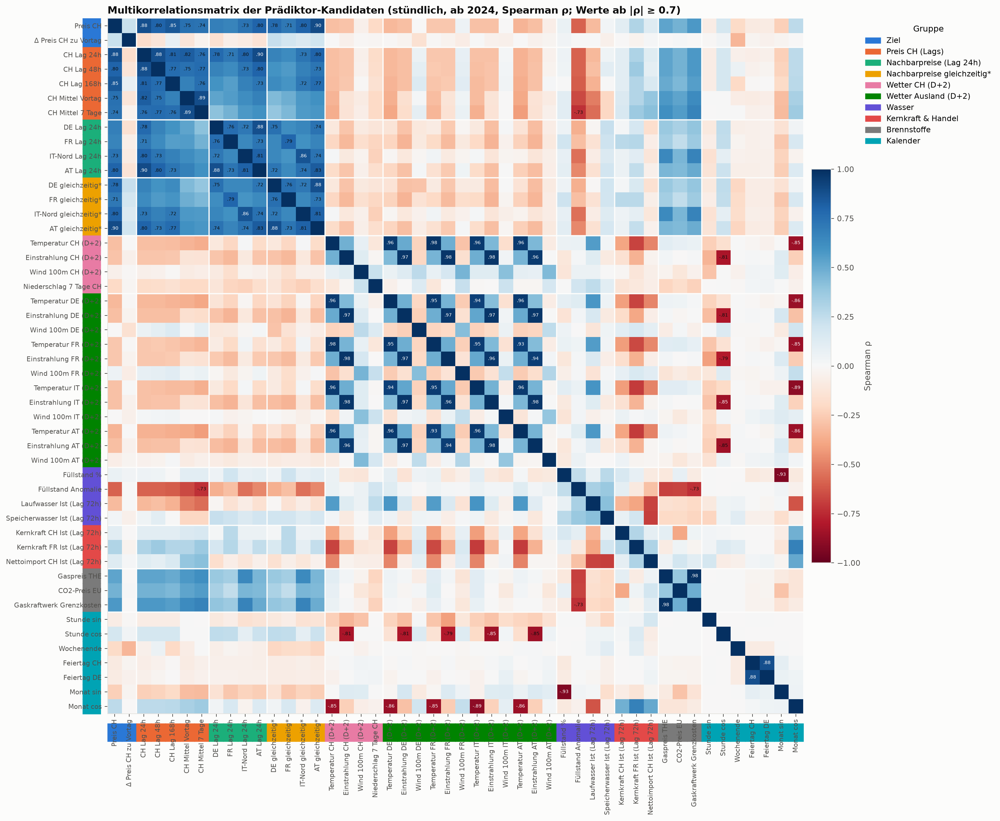

**What we see:**
- **Prices form one large block.** The Swiss lags and the neighbouring prices are strongly related (ρ 0.71–0.90); AT lag 24 h and CH lag 24 h are almost interchangeable (0.90).
- **Temperature and radiation are almost identical across all five countries** (ρ 0.93–0.98). The weather in central Europe is large-scale; one series per quantity is enough.
- **Wind differs by country** (ρ 0.06–0.47 between countries). North Sea wind in Germany is a different signal from wind in the Alps.
- **Gas price and gas-plant marginal cost** are practically the same series (0.98).
- **Some predictors are partly the season or the time of day in disguise:** the raw reservoir level follows the month (−0.93), temperature the month (−0.85), and radiation the hour of the day (−0.81).
- **German and Swiss holidays** largely coincide (0.88).

### Step 2: Relevance for the target

- **Why this figure:** Step 1 shows which predictors are redundant, but not which ones matter for the price. Here every candidate is compared with the targets on its own.
- **What we want to analyse:** Which candidates relate to the price *level*, which to the *change* against the previous day, and which to neither? A model that corrects yesterday's price needs different inputs than one that predicts the level.
- **Method:** each candidate against the price (Spearman ρ), against the price change (Spearman ρ), and against the price as mutual information, which also captures non-monotonic effects such as the hour of the day.

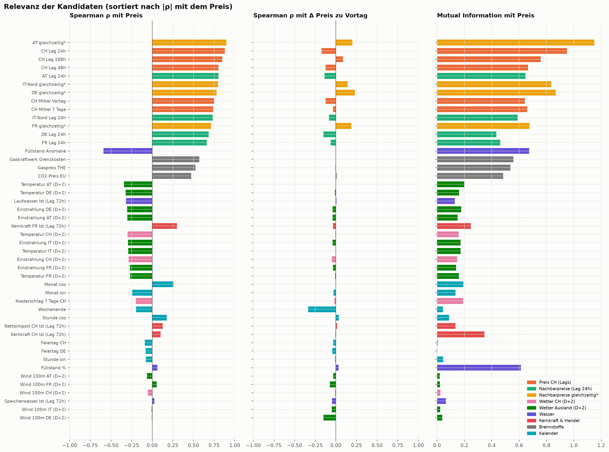

**What we see:**
- **Strongest available signals:** the Swiss price of the previous day (ρ 0.88) and of the previous week (0.85).
- **Next in line:**
  - the reservoir level relative to normal (−0.59): less water than usual → higher prices;
  - the gas-plant marginal cost (0.57);
  - temperature and radiation (both about −0.3): warm and sunny → more solar and less heating → cheaper.
- **The change against the previous day** is explained by other predictors:
  - the weekend (−0.34);
  - German wind (−0.15): more wind than yesterday makes the price cheaper. On the price *level*, wind has no effect (−0.01).

  Slow variables such as gas and the reservoir level are ≈ 0 here, because they barely change from one day to the next.
- **No relationship:** wind in CH, IT and AT, reservoir generation and the raw reservoir level (|ρ| ≤ 0.06).
- **The same-hour neighbouring prices** are the strongest signal of all (AT 0.90), but they are fixed in the same auction and unknown at forecast time. Forecasting them would be the same task as forecasting the Swiss price.
- **Caution with slow variables:** over our 2.8 years, the reservoir level, gas price and Swiss nuclear power act almost like a date stamp. Mutual information therefore overrates them (e.g. the raw reservoir level has MI 0.62 although ρ ≈ 0.06). Whether they really help is decided in the model test.

### Step 3: Clusters, keeping one predictor per group

Hierarchical clustering with the distance 1 − |ρ| groups candidates with |ρ| ≥ 0.8. In each group we keep the one with the highest relevance. Together with Steps 1 and 2, this gives the following decision:

| Decision | Count | Predictors |
|---|---|---|
| **keep** | 14 | CH lag 24 h and 168 h, CH 7-day mean; temperature CH, radiation CH and wind DE for D+2; gas-plant marginal cost; reservoir level anomaly; hour (sin/cos), weekend, Swiss holiday, month (sin/cos) |
| **shorten**: redundant, one representative is enough | 14 | CH lag 48 h, AT lag 24 h, IT-North lag 24 h, CH previous-day mean, gas price, holiday DE; temperature and radiation for DE, FR, IT and AT (8) |
| **drop**: no relationship | 5 | wind CH, IT and AT for D+2, reservoir generation, raw reservoir level |
| **not available** | 4 | same-hour neighbouring prices |
| **test in the model** | 9 | DE and FR lag 24 h, wind FR for D+2, CO₂ price, nuclear CH/FR, run-of-river, net import, 7-day precipitation. These are weak or slow signals and are kept only if they lower the error on a later test period |

### Why each of the 19 candidates is left out

- **Why this figure:** The tables say *that* a candidate is left out. The figure shows for each one *why*, so the decision can be checked by eye.
- **What we want to analyse:**
  - **Redundant (blue):** the candidate against its kept representative. If the points lie on a narrow diagonal, it measures the same thing and adds no new information.
  - **No relationship (red):** the candidate against the Swiss price. A shapeless cloud with ρ ≈ 0 means that the price is distributed the same at high and low values.
  - **Wind per country (bars):** ρ with the price and with the price change, to show which wind is kept.

  Darker areas mean more hours. The temperature and radiation of the four neighbours share one panel each.

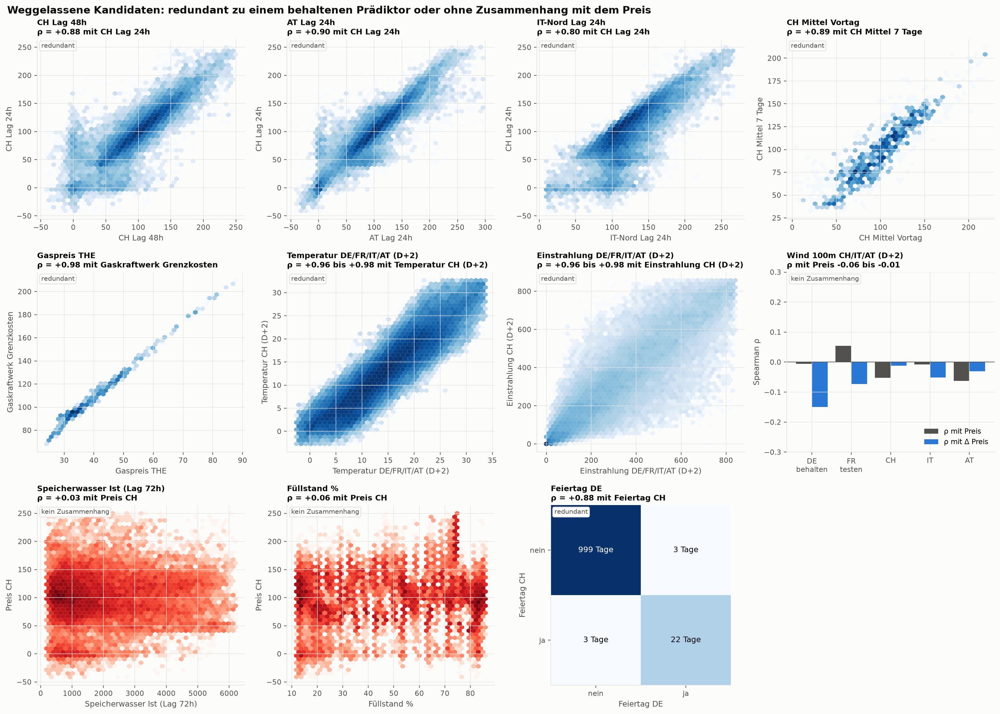

**What we see, panel by panel. Redundant (blue), shortened to one representative:**
1. **CH lag 48 h vs CH lag 24 h (ρ 0.88).** The points lie on the diagonal: the price two days ago adds little to yesterday's price. The autocorrelation confirms this; 48 h (0.74) is lower than both 24 h and 168 h.
2. **AT lag 24 h vs CH lag 24 h (ρ 0.90).** Austria and Switzerland are so closely coupled that yesterday's Austrian price is almost the Swiss one.
3. **IT-North lag 24 h vs CH lag 24 h (ρ 0.80).** It is also close, but with a wider cloud: when Italy is expensive, the Swiss price follows only partly. Still mostly the same information.
4. **CH previous-day mean vs CH 7-day mean (ρ 0.89).** Both describe the current price level. The 7-day mean is steadier, and yesterday is already covered by the 24 h lag.
5. **Gas price vs gas-plant marginal cost (ρ 0.98).** The points form an almost perfect line, because the marginal cost is computed from the gas price (2 × gas + 0.4 × CO₂). We keep the marginal cost, because it also includes CO₂ and has the unit of the electricity price.
6. **Temperature DE/FR/IT/AT vs temperature CH (ρ 0.96–0.98).** A broad but straight band: a warm day in Switzerland is a warm day in the neighbouring countries. The Swiss series represents them all.
7. **Radiation DE/FR/IT/AT vs radiation CH (ρ 0.96–0.98).** The same for the sun. The cloud is wider than for temperature, because clouds are more local, but the ranks still match.
8. **Wind CH, IT and AT (bars).** Only German wind relates to the price change (ρ −0.15), French wind weakly (−0.07) and is tested in the model. Wind in Switzerland, Italy and Austria shows |ρ| ≤ 0.06 for both targets; these countries have little wind power (Switzerland about 18 MW on average).

**No relationship with the price (red), dropped:**

9. **Reservoir generation 72 h earlier (ρ +0.03).** Storage plants run *because* the price is high (they adapt to it), not the other way round. Three days later this says nothing about the price.
10. **Raw reservoir level (ρ +0.06).** The vertical stripes are the weeks of the year: the level only describes the season (ρ −0.93 with the month). Its **deviation from a normal year** is kept instead (ρ −0.59).

**Redundant, shown as a table (both are 0 or 1):**

11. **Holiday DE vs holiday CH (ρ 0.88).** Of 28 holidays, 22 are shared; only 3 are German-only and 3 Swiss-only.

These are pairwise statistics. A tree model can still exploit interactions, for example solar matters only around midday. The list is the starting point for `03_modeling`, where the groups are added step by step and evaluated on a later test period.

### Model choice: XGBoost

Based on these findings, we chose **XGBoost** (gradient-boosted decision trees).

**Why not a classical time-series model (ARIMA, SARIMA, SARIMAX)?** These models describe a series by its own past with fixed parameters. Our series breaks the assumptions they rely on:
- **The series is not stable.** The price level changes sharply between years (the 2022 crisis; from 76 EUR/MWh in 2024 to 128 EUR/MWh in 2026), and the market switched to 15-minute products on 01.10.2025. SARIMA assumes that the structure of the series stays the same after differencing.
- **It has several seasonalities at once:** the day (24 h), the week (168 h) and the year. SARIMA handles one seasonal period well; several make it slow and unstable.
- **Extreme values.** Negative prices down to −464 EUR/MWh and spikes up to 872 EUR/MWh distort a linear model with normally distributed errors.
- **Many external drivers with non-linear effects.** SARIMAX can include external variables, but only *linearly*. The effect of wind on the price depends on whether gas plants are needed (merit order), and a holiday has a different effect at midday than in the evening.

**Why not multiple linear regression?** It is simple and easy to explain, and it serves as our baseline. It assumes, however, that every predictor adds a fixed amount to the price, independently of all others. That does not match how the market works: more demand hardly matters while hydro and nuclear cover it, and becomes expensive once gas plants are needed. Solar lowers the price only at midday, and only in summer. A linear model can only represent such thresholds and interactions with many hand-made extra terms.

**XGBoost vs random forest.** Both combine many decision trees, which handle thresholds, interactions and extreme values naturally:
- A **random forest** grows hundreds of *independent* trees on random parts of the data and averages them (bagging). It is robust, but each tree learns the same thing; small, systematic effects are smoothed out by the averaging.
- **XGBoost** grows the trees *one after another*. Each new tree learns the error that the previous trees still make (boosting). The model therefore keeps improving where it is still wrong, for example in evening hours or at negative prices. With a learning rate and regularisation it does not chase every outlier. XGBoost also handles missing values natively and is fast.

**Pretest.**
- **Why this figure:** The selection so far rests on correlations. Before the actual modelling we check two decisions on a separate test period: whether the archived weather forecasts are worth the effort, and which type of model fits.
- **What we want to analyse:** Left, how much the error drops with the weather forecast compared with no forecast and with the (unavailable) TSO forecast. Right, how linear regression, random forest and XGBoost compare with the same predictors (kept ones including the weather forecast).

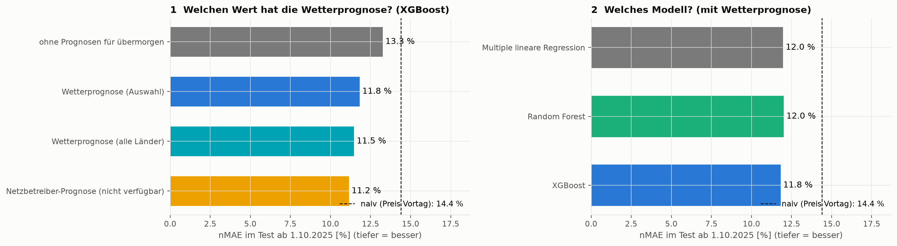

| Model | nMAE in test |
|---|---|
| Naive: price of the previous day | 14.4 % |
| Multiple linear regression | 12.0 % |
| Random forest | 12.0 % |
| **XGBoost** | **11.8 %** |

- **What we see:** XGBoost is slightly ahead of both the random forest and the linear regression. The margin is small in this untuned comparison. The linear regression does surprisingly well because the target is the change against the previous day: the lags already provide the price level, and only a correction is left to learn. The tree models are expected to gain more from tuning and from the interactions above. The actual modelling, with tuning and the step-by-step selection of the "test in the model" candidates, follows in `03_modeling.ipynb`, with linear regression and random forest kept as reference models.

### Possible extension: converting the weather into solar, wind and load

**How the idea came up.** When preparing the forecasts we asked why the TSO forecasts for solar, wind and load cannot simply be used for D+2. The answer was timing: they are only published for the next day, in the evening of D+1. So we asked the next question: *is there no weather API that forecasts two days ahead?* There is, but it delivers **weather** (W/m², km/h, °C), not **production in megawatts**. The TSOs close this gap with their own models, which convert the weather forecast into solar, wind and load forecasts.

**What the extension would do.** An intermediate model per country and quantity would learn to map the weather forecast plus the calendar (and a trend for new solar and wind capacity) to the measured production. From its output the **residual load** for D+2 could be computed (load − solar − wind). This is the quantity that physically sets the price via the merit order, and it was the strongest driver in the EDA.

**Why it could be worth it.**
- The price model would get a few physically meaningful inputs in MW instead of many raw weather series, and would no longer have to learn the detour *weather → production → price* by itself.
- The growth of solar and wind capacity over the years would be handled in the intermediate model; for the price model the same wind speed would otherwise mean more production every year.
- The intermediate model must be trained out-of-fold (each period estimated by a model that has not seen it), otherwise its estimates would be too good in training.

**Why we leave it out for now.** We built a first version and tested it. It added a second model and about 25 minutes of computing time, and in the pretest it was **not better** than giving the weather forecast directly to XGBoost (12.3 % vs 11.8 % nMAE). Wind two days ahead is hard to convert precisely (22–44 % error per country), and XGBoost already learns the relationship from the weather. The extension becomes interesting if the conversion improves, for example with installed capacity per region, curtailment information or better weather points for offshore wind.

## Implementation
*Make a reference to the notebook and scripts used for performing the data modeling. Sketch a diagram that contains all major tasks and notes for the corresponding implementation.*

- Notebook to run the data modeling: [03_modeling.ipynb](notebooks/03_modeling.ipynb)
- Reusable, modular code is outsourced to separate `.py` files: [src/data_modeling.py](src/data_modeling.py)


# 5. Evaluation

> ⚠️ **Deliverable - 10.12.2026:** Discuss your results in the light of the project goals.

- Notebook to run the evaluation: [04_evaluation.ipynb](notebooks/04_evaluation.ipynb)

- All visualizations can be found in `figures/eval`.


## Results
*List major results. Results often come in the form of evaluation metrics.  A short introduction can be found [here](https://www.ibm.com/think/topics/model-evaluation).*

## Interpretation
*Interpret results in the light of the problem statement. Could you solve the problem? An important issue in the interpretation is practical applicability. Is your solution generalizable?*

## Limitations
*Describe weaknesses of your approach or the underlying data.*

---

# 6. Sustainable Development Goals

> ⚠️ **Deliverable - 17.12.2026:** Describe your results in the light of sustainability.

*The United Nations distinguishes 17 Sustainable Development Goals ([link](https://sdgs.un.org/goals)). Put the results of your project in relation to at least one of these goals. A four-sentence description is sufficient.*
