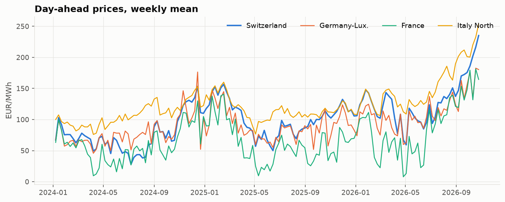
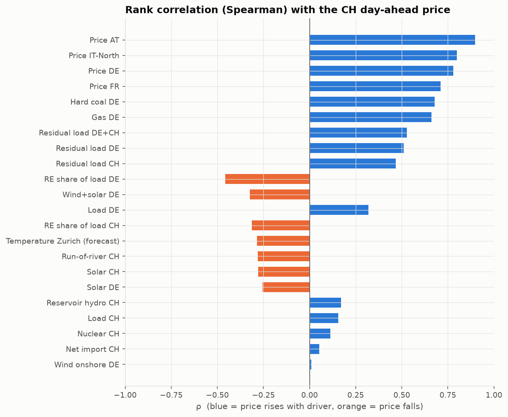
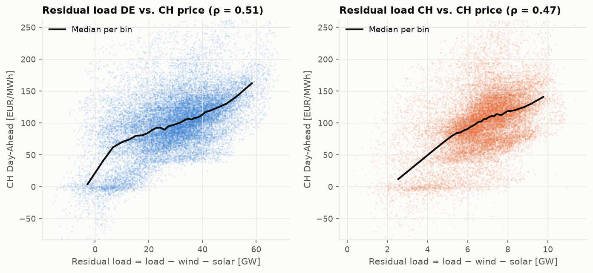
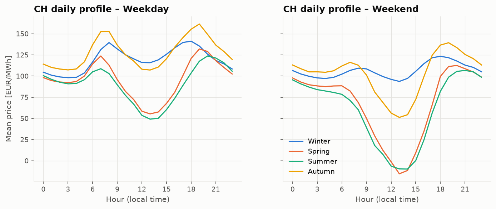
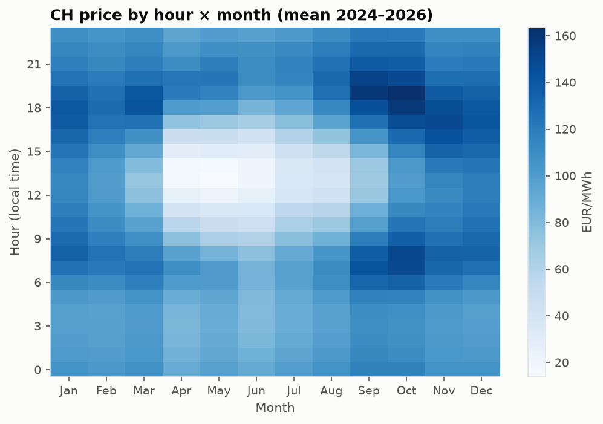
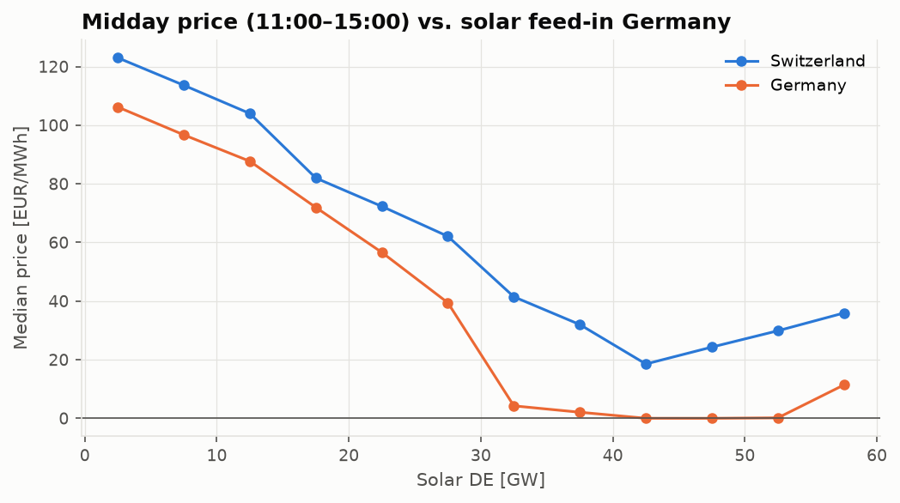
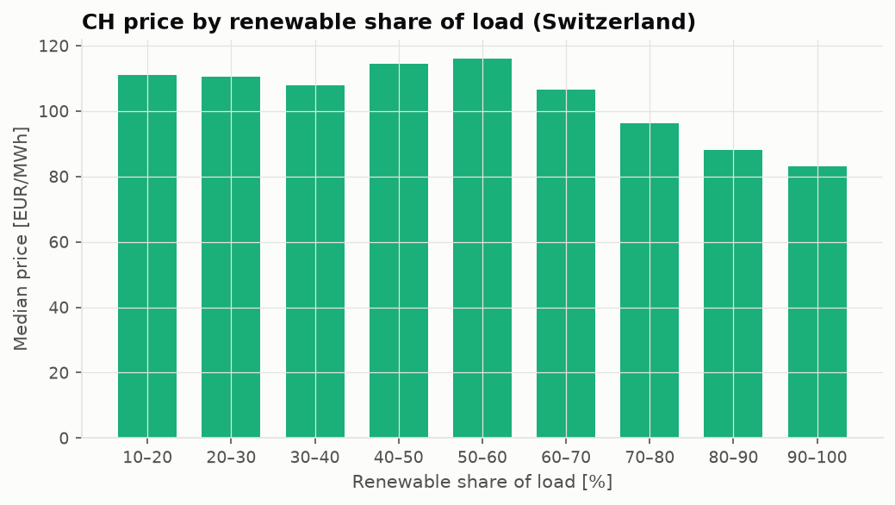
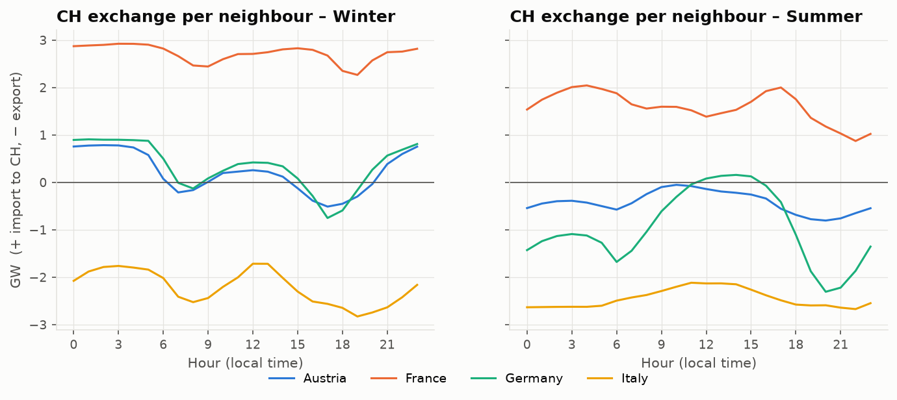
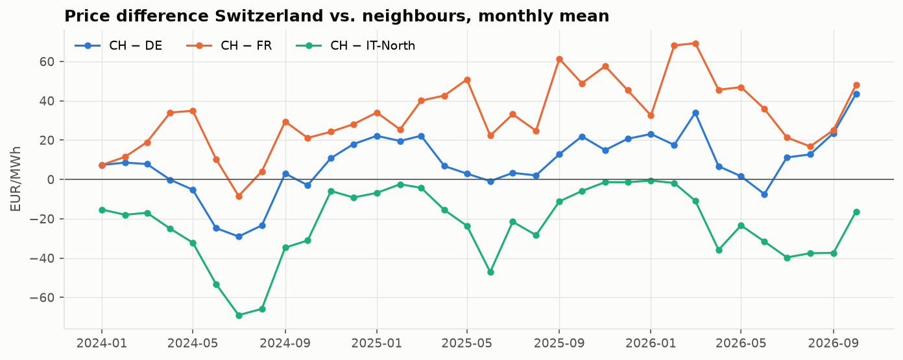

# EDA – price drivers of the Swiss day-ahead price

Period: 2024-01-01 to 2026-10-23, 24646 hours.

## Statistics per year (CH day-ahead, EUR/MWh)

|   year |   Mean |   Median |   Std |    Min |   Max |   Neg. hours |   Hours |   Neg. hours DE |
|-------:|-------:|---------:|------:|-------:|------:|-------------:|--------:|----------------:|
|   2024 |   76   |     75.8 |  39   | -427.5 | 310.6 |          292 |    8783 |             457 |
|   2025 |  101.7 |    104.6 |  40.8 | -262.2 | 318   |          303 |    8760 |             576 |
|   2026 |  128.4 |    131   |  57.9 | -463.7 | 330   |          239 |    7103 |             472 |

Mean daily spread (max − min) CH: 82.3 EUR/MWh

## Charts

## Correlation of the drivers with the CH price

| Driver                        |   Pearson r |   Spearman ρ |     n |
|:------------------------------|------------:|-------------:|------:|
| Price AT                      |        0.85 |         0.90 | 24646 |
| Price IT-North                |        0.81 |         0.80 | 24646 |
| Price DE                      |        0.79 |         0.78 | 24646 |
| Price FR                      |        0.76 |         0.71 | 24646 |
| Hard coal DE                  |        0.60 |         0.68 | 24621 |
| Gas DE                        |        0.57 |         0.66 | 24621 |
| Residual load DE+CH           |        0.57 |         0.53 | 24619 |
| Residual load DE              |        0.55 |         0.51 | 24621 |
| Residual load CH              |        0.50 |         0.47 | 24619 |
| RE share of load DE           |       -0.52 |        -0.46 | 24621 |
| Wind+solar DE                 |       -0.37 |        -0.32 | 24621 |
| Load DE                       |        0.32 |         0.32 | 24621 |
| RE share of load CH           |       -0.30 |        -0.31 | 24619 |
| Temperature Zurich (forecast) |       -0.26 |        -0.29 | 24202 |
| Run-of-river CH               |       -0.23 |        -0.28 | 24619 |
| Solar CH                      |       -0.45 |        -0.28 | 24619 |
| Solar DE                      |       -0.44 |        -0.26 | 24621 |
| Reservoir hydro CH            |        0.19 |         0.17 | 24619 |
| Load CH                       |        0.12 |         0.16 | 24619 |
| Nuclear CH                    |        0.13 |         0.11 | 24619 |
| Net import CH                 |        0.03 |         0.05 | 24646 |
| Wind onshore DE               |        0.01 |         0.01 | 24621 |
