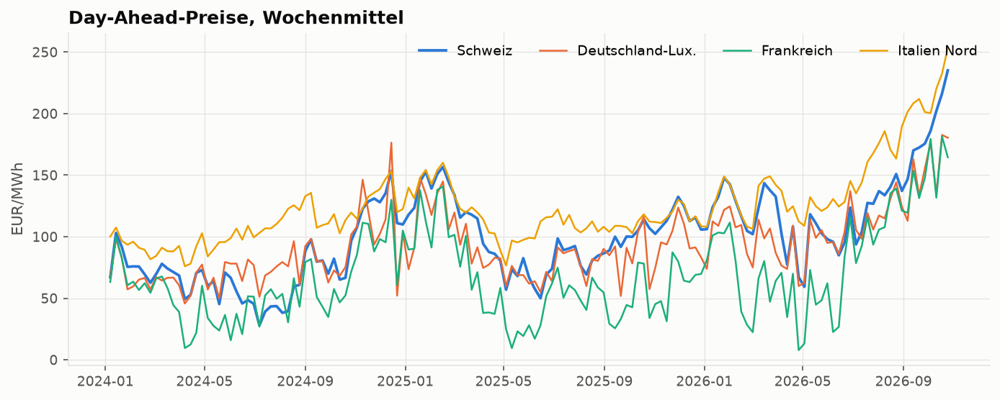
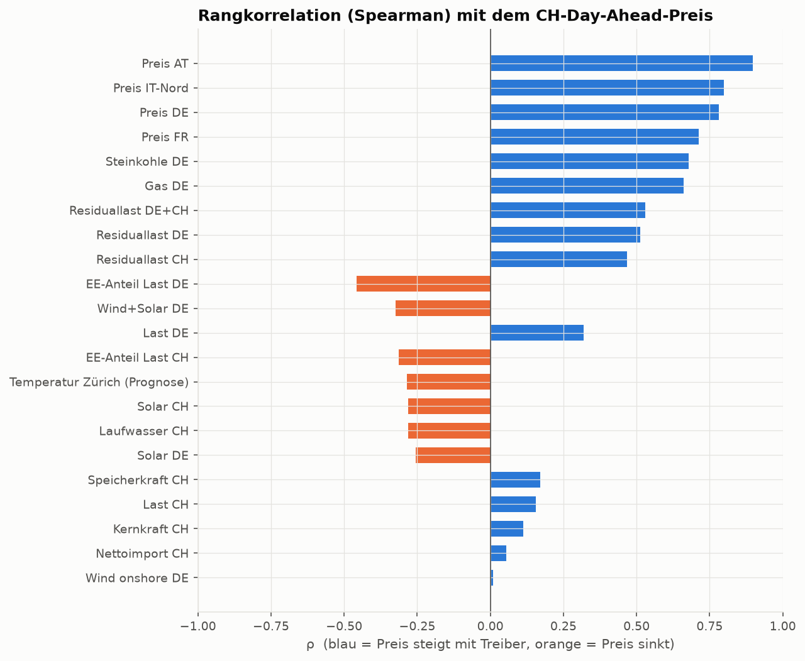
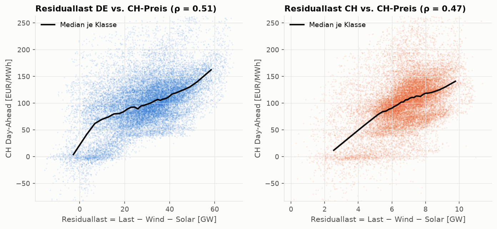
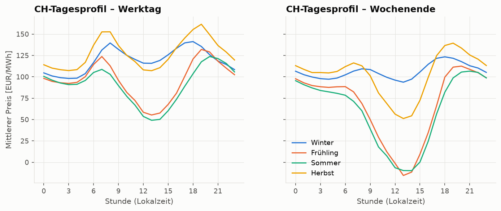
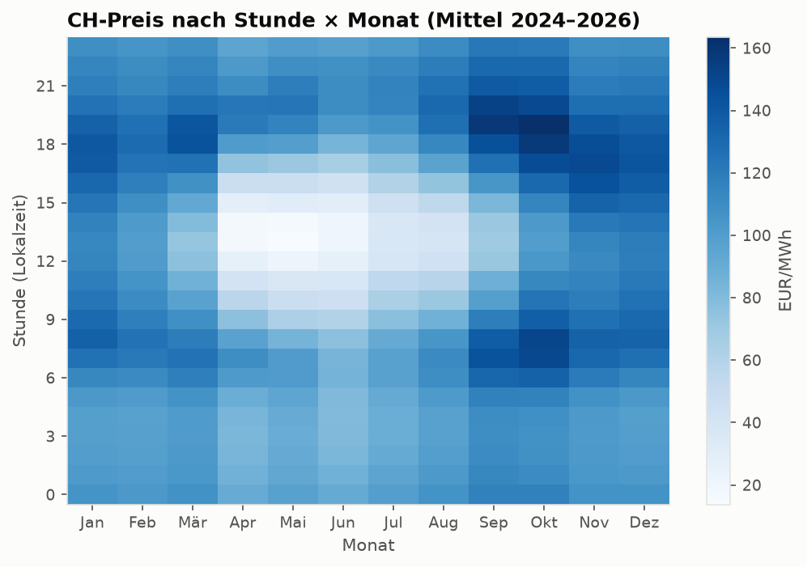
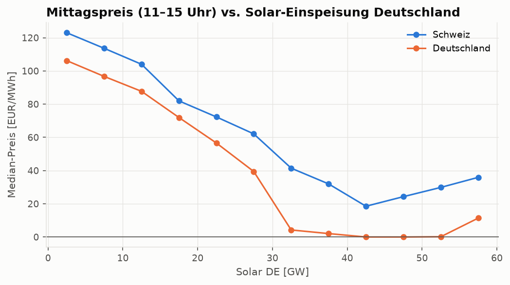
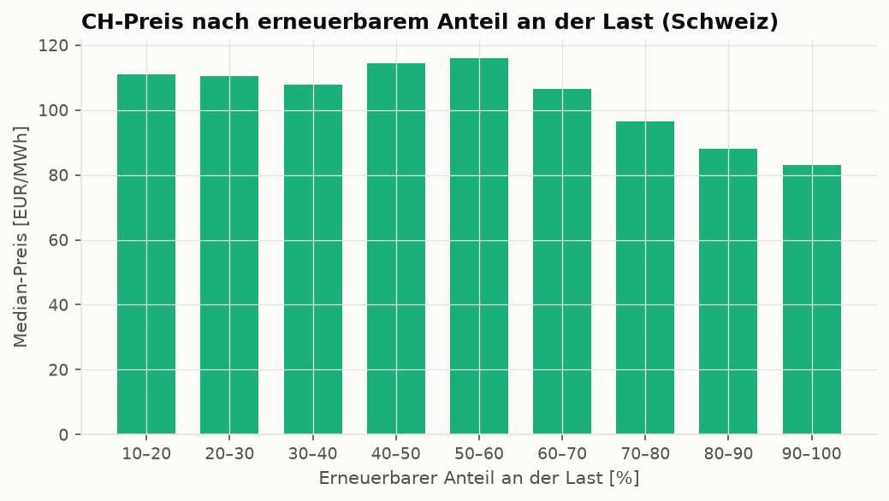
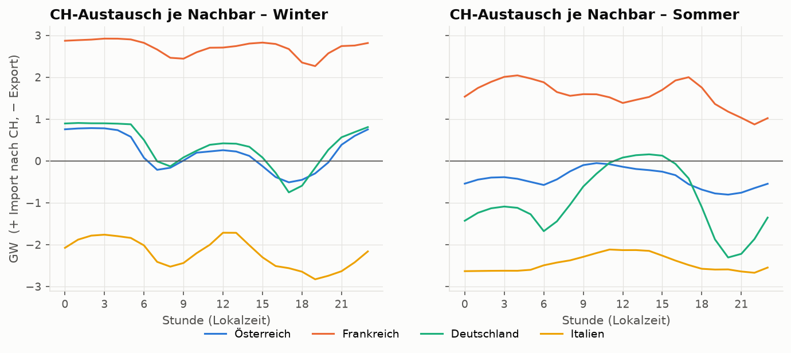
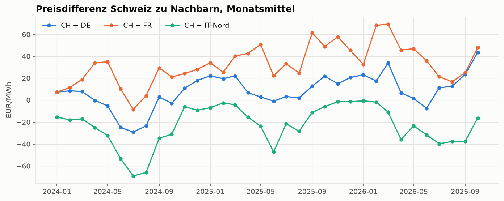

# EDA – Preistreiber des Schweizer Day-Ahead-Preises

Zeitraum: 2024-01-01 bis 2026-10-23, 24646 Stunden.

## Kennzahlen je Jahr (CH Day-Ahead, EUR/MWh)

|   year |   Mittel |   Median |   Std |    Min |   Max |   Std. negativ |   Stunden |   Std. negativ DE |
|-------:|---------:|---------:|------:|-------:|------:|---------------:|----------:|------------------:|
|   2024 |     76   |     75.8 |  39   | -427.5 | 310.6 |            292 |      8783 |               457 |
|   2025 |    101.7 |    104.6 |  40.8 | -262.2 | 318   |            303 |      8760 |               576 |
|   2026 |    128.4 |    131   |  57.9 | -463.7 | 330   |            239 |      7103 |               472 |

Mittlere Tagesspanne (max − min) CH: 82.3 EUR/MWh

## Grafiken

## Korrelation der Treiber mit dem CH-Preis

| Treiber                      |   Pearson r |   Spearman ρ |     n |
|:-----------------------------|------------:|-------------:|------:|
| Preis AT                     |        0.85 |         0.90 | 24646 |
| Preis IT-Nord                |        0.81 |         0.80 | 24646 |
| Preis DE                     |        0.79 |         0.78 | 24646 |
| Preis FR                     |        0.76 |         0.71 | 24646 |
| Steinkohle DE                |        0.60 |         0.68 | 24615 |
| Gas DE                       |        0.57 |         0.66 | 24615 |
| Residuallast DE+CH           |        0.57 |         0.53 | 24611 |
| Residuallast DE              |        0.55 |         0.51 | 24614 |
| Residuallast CH              |        0.50 |         0.47 | 24611 |
| EE-Anteil Last DE            |       -0.52 |        -0.46 | 24614 |
| Wind+Solar DE                |       -0.37 |        -0.32 | 24615 |
| Last DE                      |        0.32 |         0.32 | 24615 |
| EE-Anteil Last CH            |       -0.30 |        -0.31 | 24611 |
| Temperatur Zürich (Prognose) |       -0.26 |        -0.29 | 24202 |
| Solar CH                     |       -0.45 |        -0.28 | 24611 |
| Laufwasser CH                |       -0.23 |        -0.28 | 24614 |
| Solar DE                     |       -0.44 |        -0.25 | 24614 |
| Speicherkraft CH             |        0.19 |         0.17 | 24614 |
| Last CH                      |        0.12 |         0.16 | 24611 |
| Kernkraft CH                 |        0.12 |         0.11 | 24614 |
| Nettoimport CH               |        0.03 |         0.05 | 24646 |
| Wind onshore DE              |        0.01 |         0.01 | 24615 |
