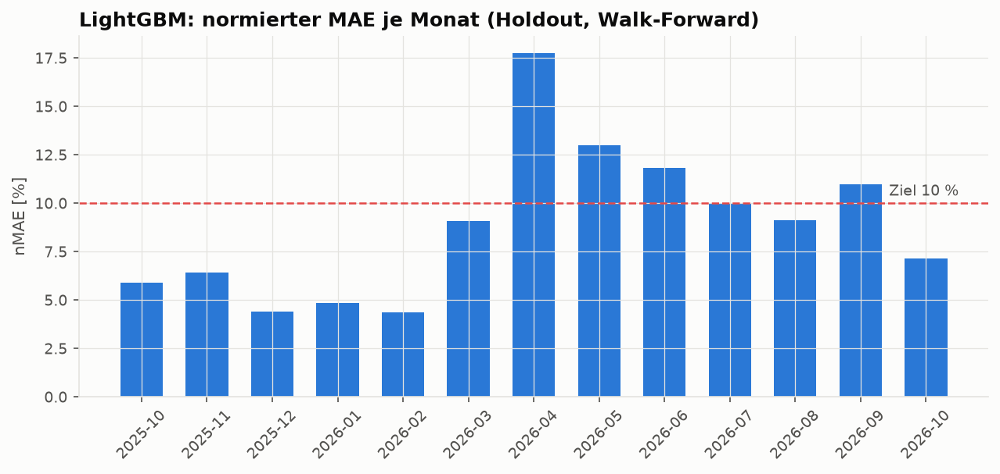
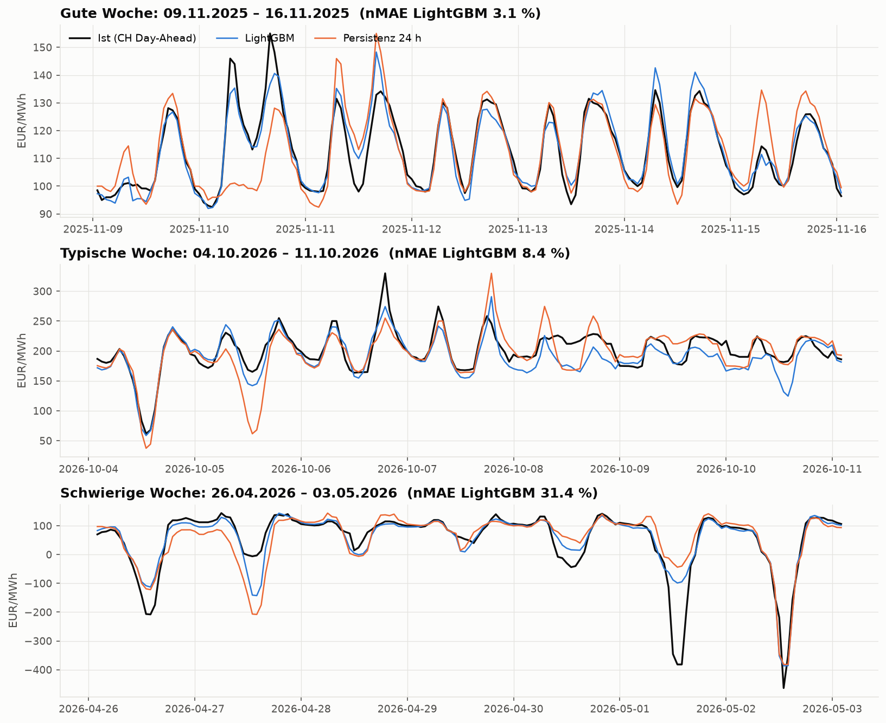
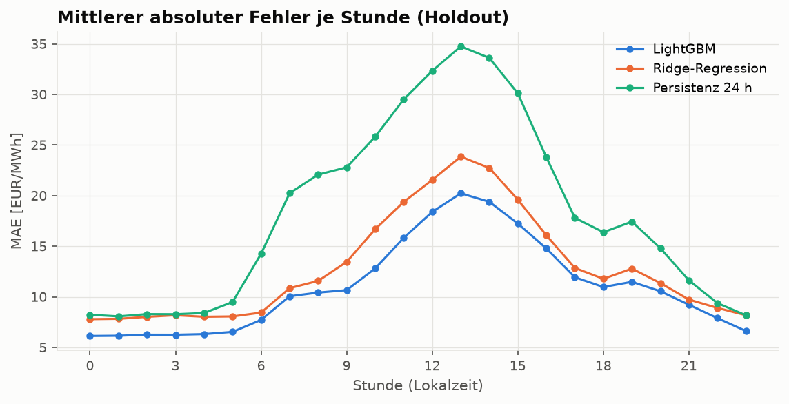
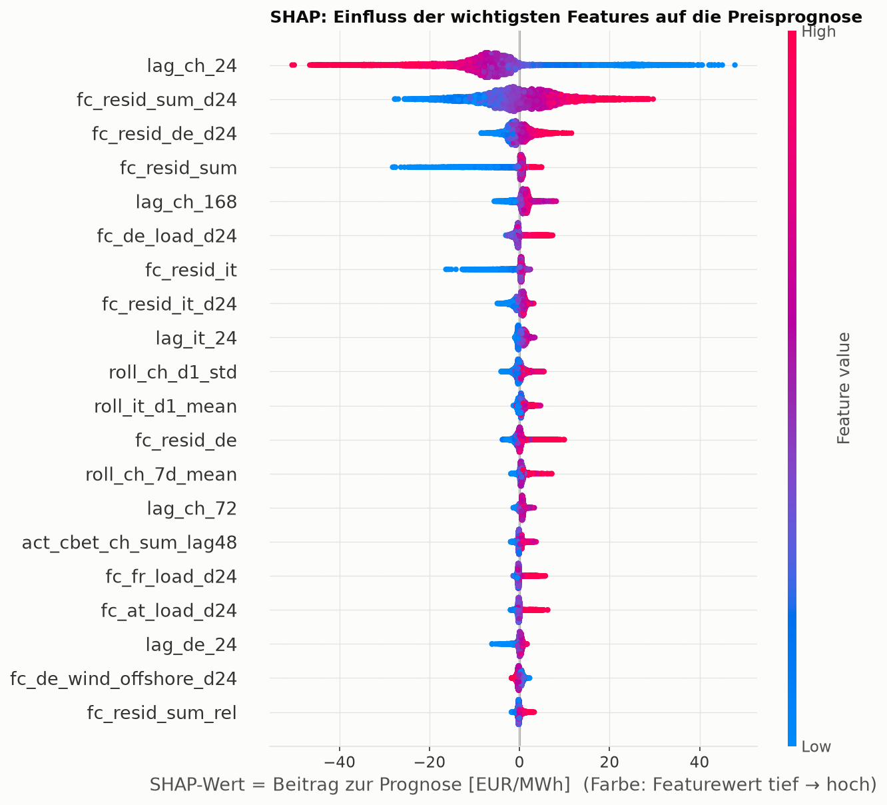
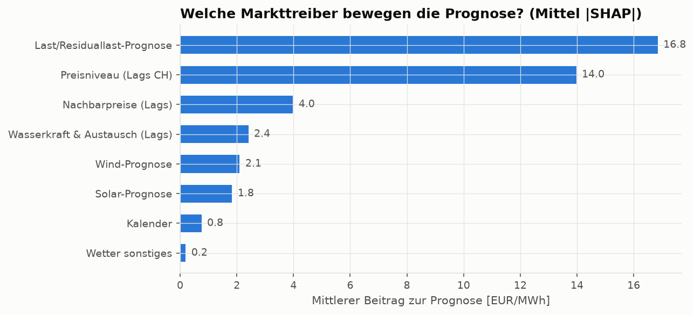
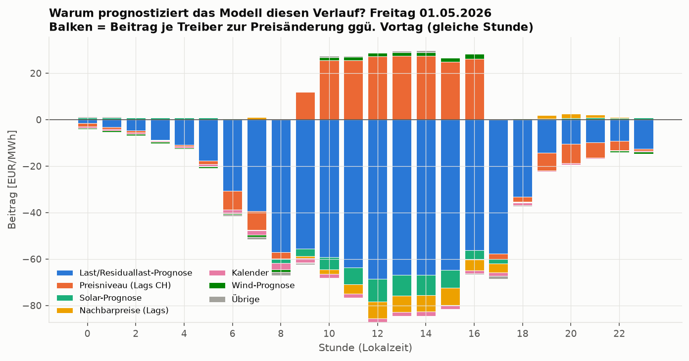
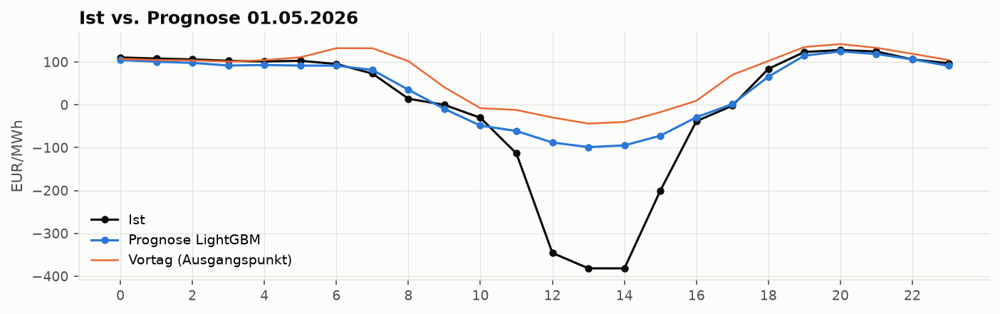
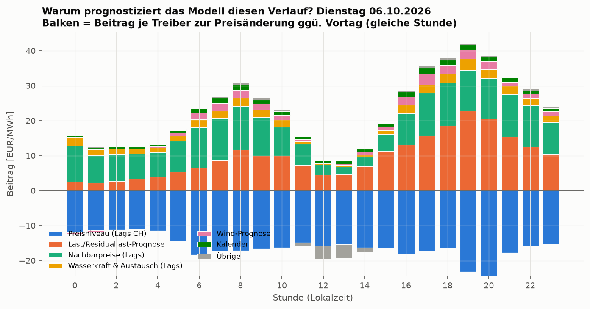
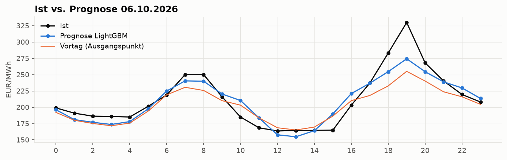

# LightGBM-Prognose des CH-Day-Ahead-Preises (24 h im Voraus)

106 Features, Training ab 2024-01-01, Holdout ab 2025-10-01.

## Hyperparameter (TimeSeriesSplit, 5 Folds à 60 Tage, 24 h Lücke)

Bester CV-MAE: 9.73 ± 0.86 EUR/MWh

```json
{
  "objective": "regression_l1",
  "learning_rate": 0.02,
  "n_estimators": 1000,
  "num_leaves": 127,
  "min_child_samples": 50,
  "feature_fraction": 0.9,
  "bagging_fraction": 1.0,
  "bagging_freq": 1,
  "lambda_l2": 5.0
}
```

## Ergebnis Holdout (01.10.2025 – 23.10.2026, 9312 Stunden)

Mittlerer Absolutpreis: 126.3 EUR/MWh. nMAE = MAE / mittlerer Absolutpreis.

| Modell                                |   MAE |   nMAE_% |   RMSE |    n |   Verbesserung ggü. Persistenz_% |
|:--------------------------------------|------:|---------:|-------:|-----:|---------------------------------:|
| LightGBM                              | 10.99 |     8.70 |  19.13 | 9312 |                            39.44 |
| LightGBM ohne Netzbetreiber-Prognosen | 13.06 |    10.34 |  21.80 | 9312 |                            28.04 |
| Ridge-Regression                      | 12.82 |    10.15 |  19.89 | 9312 |                            29.37 |
| Profil 14 Tage                        | 18.10 |    14.32 |  28.92 | 9312 |                             0.31 |
| Persistenz 24 h                       | 18.15 |    14.37 |  31.62 | 9312 |                             0.00 |
| Persistenz 168 h                      | 22.35 |    17.69 |  36.09 | 9312 |                           -23.11 |

**Ziel nMAE < 10 %: erreicht** (LightGBM 8.7 %).

### Je Monat

| Monat   |   MAE |   nMAE_% |   RMSE |   n |
|:--------|------:|---------:|-------:|----:|
| 2025-10 |  6.26 |     5.89 |   8.67 | 745 |
| 2025-11 |  7.51 |     6.43 |  14.59 | 720 |
| 2025-12 |  5.04 |     4.42 |   7.43 | 744 |
| 2026-01 |  6.49 |     4.87 |  10.25 | 744 |
| 2026-02 |  4.98 |     4.36 |   6.76 | 672 |
| 2026-03 | 12.10 |     9.08 |  18.07 | 743 |
| 2026-04 | 16.78 |    17.74 |  26.49 | 720 |
| 2026-05 | 14.22 |    13.01 |  34.04 | 744 |
| 2026-06 | 12.35 |    11.82 |  19.54 | 720 |
| 2026-07 | 11.71 |    10.00 |  18.17 | 744 |
| 2026-08 | 12.77 |     9.13 |  18.59 | 744 |
| 2026-09 | 18.49 |    10.98 |  25.18 | 720 |
| 2026-10 | 15.06 |     7.14 |  19.32 | 552 |

8 von 13 Monaten unter 10 %.

CH-Day-Ahead im Holdout in 0 days 01:00:00 Auflösung – keine separate 15-min-Auswertung nötig.

## Grafiken











## Erklärung mit SHAP













**Freitag 01.05.2026, 13:00 Uhr** – Prognose -98.7 EUR/MWh, Ist -381.7 EUR/MWh. Ausgangspunkt Vortag -43.8 EUR/MWh, mittlere Modellkorrektur +0.1; wichtigste Beiträge zur Änderung:

- `lag_ch_24` = -43.8 → +28.9 EUR/MWh (Preisniveau (Lags CH))
- `fc_resid_sum_d24` = -35031.6 → -19.4 EUR/MWh (Last/Residuallast-Prognose)
- `fc_resid_sum` = 12611.3 → -12.7 EUR/MWh (Last/Residuallast-Prognose)
- `fc_resid_it` = -7816.0 → -6.7 EUR/MWh (Last/Residuallast-Prognose)
- `fc_resid_de` = -8155.4 → -3.5 EUR/MWh (Last/Residuallast-Prognose)
- `fc_resid_sum_dmean` = 62717.3 → -3.4 EUR/MWh (Last/Residuallast-Prognose)







**Dienstag 06.10.2026, 19:00 Uhr** – Prognose 274.3 EUR/MWh, Ist 330.0 EUR/MWh. Ausgangspunkt Vortag 255.1 EUR/MWh, mittlere Modellkorrektur +0.2; wichtigste Beiträge zur Änderung:

- `lag_ch_24` = 255.1 → -28.0 EUR/MWh (Preisniveau (Lags CH))
- `fc_resid_sum_d24` = 11251.5 → +9.6 EUR/MWh (Last/Residuallast-Prognose)
- `fc_resid_de` = 59154.9 → +6.4 EUR/MWh (Last/Residuallast-Prognose)
- `fc_resid_de_d24` = 13671.4 → +3.2 EUR/MWh (Last/Residuallast-Prognose)
- `roll_it_d1_mean` = 210.4 → +3.0 EUR/MWh (Nachbarpreise (Lags))
- `fc_resid_sum_rel` = 41993.1 → +2.4 EUR/MWh (Last/Residuallast-Prognose)

