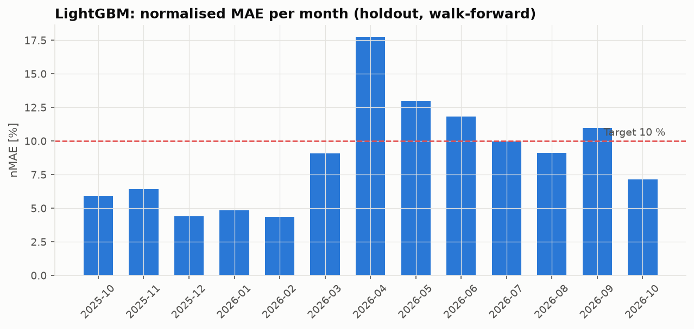
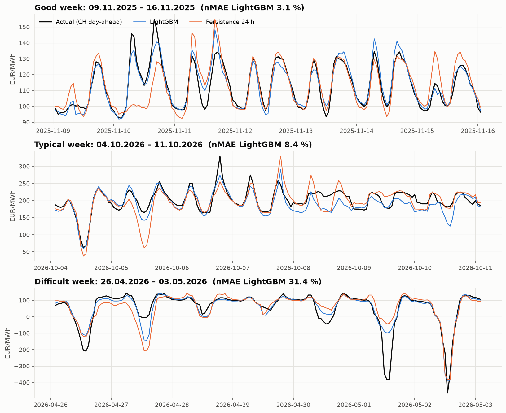
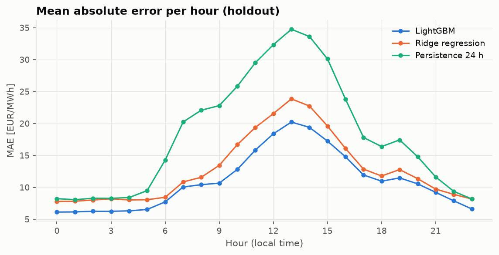
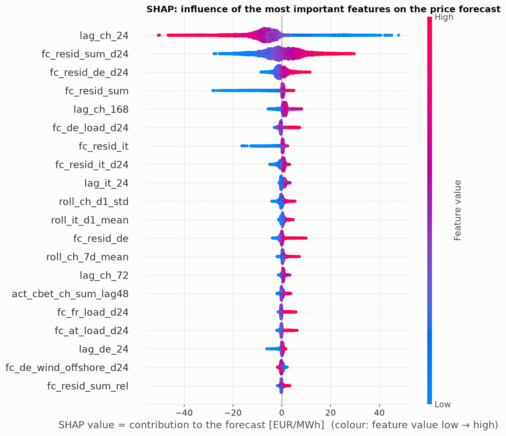
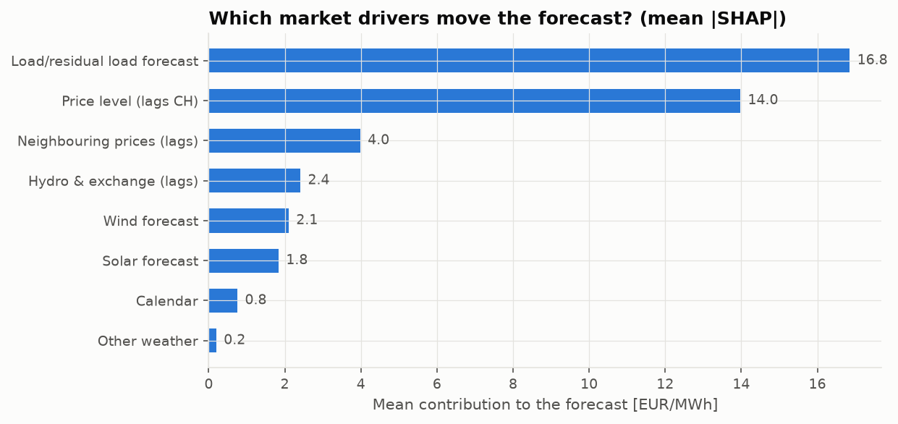
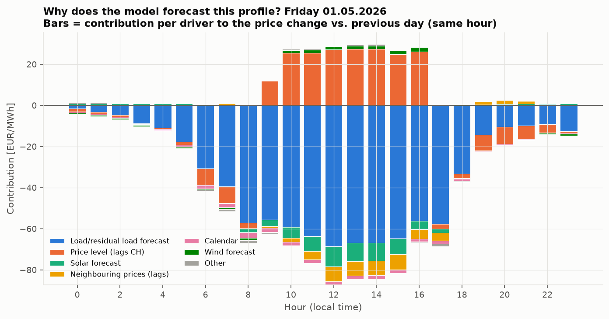
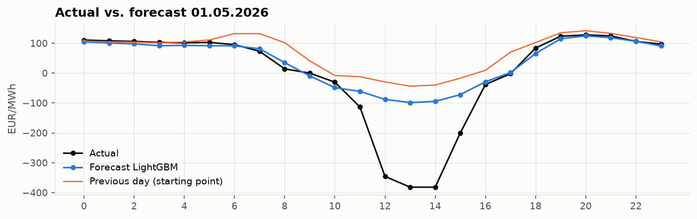
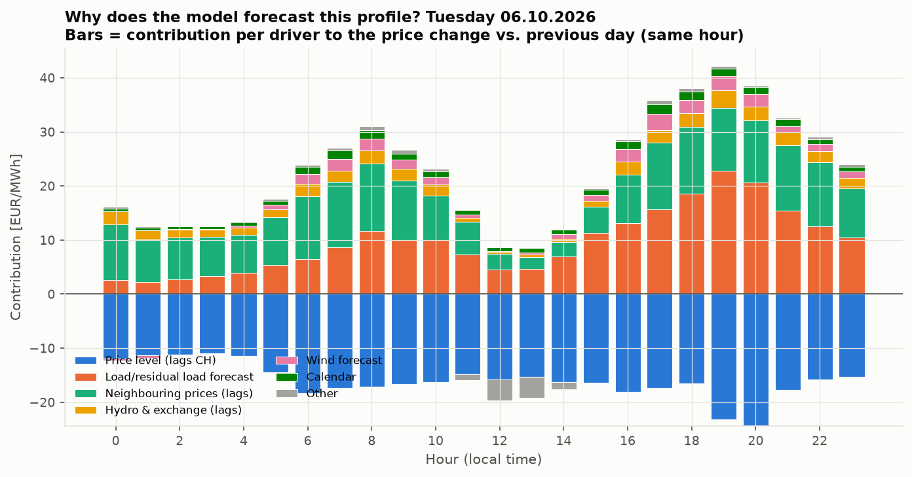
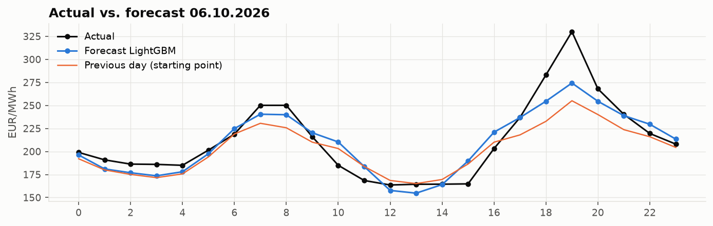

# LightGBM forecast of the CH day-ahead price (24 h ahead)

106 features, training from 2024-01-01, holdout from 2025-10-01.

## Hyperparameters (TimeSeriesSplit, 5 folds of 60 days, 24 h gap)

Best CV MAE: 9.73 ± 0.86 EUR/MWh

```json
{
  "objective": "regression_l1",
  "learning_rate": 0.02,
  "n_estimators": 1000,
  "num_leaves": 127,
  "min_child_samples": 50,
  "feature_fraction": 0.9,
  "bagging_fraction": 1.0,
  "bagging_freq": 1,
  "lambda_l2": 5.0
}
```

## Holdout result (01.10.2025 – 23.10.2026, 9312 hours)

Mean absolute price: 126.3 EUR/MWh. nMAE = MAE / mean absolute price.

| Model                                    |   MAE |   nMAE_% |   RMSE |    n |   Improvement vs. persistence_% |
|:-----------------------------------------|------:|---------:|-------:|-----:|--------------------------------:|
| LightGBM                                 | 10.99 |     8.70 |  19.13 | 9312 |                           39.44 |
| LightGBM without grid operator forecasts | 13.06 |    10.34 |  21.80 | 9312 |                           28.04 |
| Ridge regression                         | 12.82 |    10.15 |  19.89 | 9312 |                           29.37 |
| Profile 14 days                          | 18.10 |    14.32 |  28.92 | 9312 |                            0.31 |
| Persistence 24 h                         | 18.15 |    14.37 |  31.62 | 9312 |                            0.00 |
| Persistence 168 h                        | 22.35 |    17.69 |  36.09 | 9312 |                          -23.11 |

**Target nMAE < 10 %: achieved** (LightGBM 8.7 %).

### Per month

| Month   |   MAE |   nMAE_% |   RMSE |   n |
|:--------|------:|---------:|-------:|----:|
| 2025-10 |  6.26 |     5.89 |   8.67 | 745 |
| 2025-11 |  7.51 |     6.43 |  14.59 | 720 |
| 2025-12 |  5.04 |     4.42 |   7.43 | 744 |
| 2026-01 |  6.49 |     4.87 |  10.25 | 744 |
| 2026-02 |  4.98 |     4.36 |   6.76 | 672 |
| 2026-03 | 12.10 |     9.08 |  18.07 | 743 |
| 2026-04 | 16.78 |    17.74 |  26.49 | 720 |
| 2026-05 | 14.22 |    13.01 |  34.04 | 744 |
| 2026-06 | 12.35 |    11.82 |  19.54 | 720 |
| 2026-07 | 11.71 |    10.00 |  18.17 | 744 |
| 2026-08 | 12.77 |     9.13 |  18.59 | 744 |
| 2026-09 | 18.49 |    10.98 |  25.18 | 720 |
| 2026-10 | 15.06 |     7.14 |  19.32 | 552 |

8 of 13 months below 10 %.

CH day-ahead in the holdout at 0 days 01:00:00 resolution – no separate 15 min evaluation needed.

## Charts











## Explanation with SHAP













**Friday 01.05.2026, 13:00** – forecast -98.7 EUR/MWh, actual -381.7 EUR/MWh. Starting point previous day -43.8 EUR/MWh, mean model correction +0.1; most important contributions to the change:

- `lag_ch_24` = -43.8 → +28.9 EUR/MWh (Price level (lags CH))
- `fc_resid_sum_d24` = -35031.6 → -19.4 EUR/MWh (Load/residual load forecast)
- `fc_resid_sum` = 12611.3 → -12.7 EUR/MWh (Load/residual load forecast)
- `fc_resid_it` = -7816.0 → -6.7 EUR/MWh (Load/residual load forecast)
- `fc_resid_de` = -8155.4 → -3.5 EUR/MWh (Load/residual load forecast)
- `fc_resid_sum_dmean` = 62717.3 → -3.4 EUR/MWh (Load/residual load forecast)







**Tuesday 06.10.2026, 19:00** – forecast 274.3 EUR/MWh, actual 330.0 EUR/MWh. Starting point previous day 255.1 EUR/MWh, mean model correction +0.2; most important contributions to the change:

- `lag_ch_24` = 255.1 → -28.0 EUR/MWh (Price level (lags CH))
- `fc_resid_sum_d24` = 11251.5 → +9.6 EUR/MWh (Load/residual load forecast)
- `fc_resid_de` = 59154.9 → +6.4 EUR/MWh (Load/residual load forecast)
- `fc_resid_de_d24` = 13671.4 → +3.2 EUR/MWh (Load/residual load forecast)
- `roll_it_d1_mean` = 210.4 → +3.0 EUR/MWh (Neighbouring prices (lags))
- `fc_resid_sum_rel` = 41993.1 → +2.4 EUR/MWh (Load/residual load forecast)

