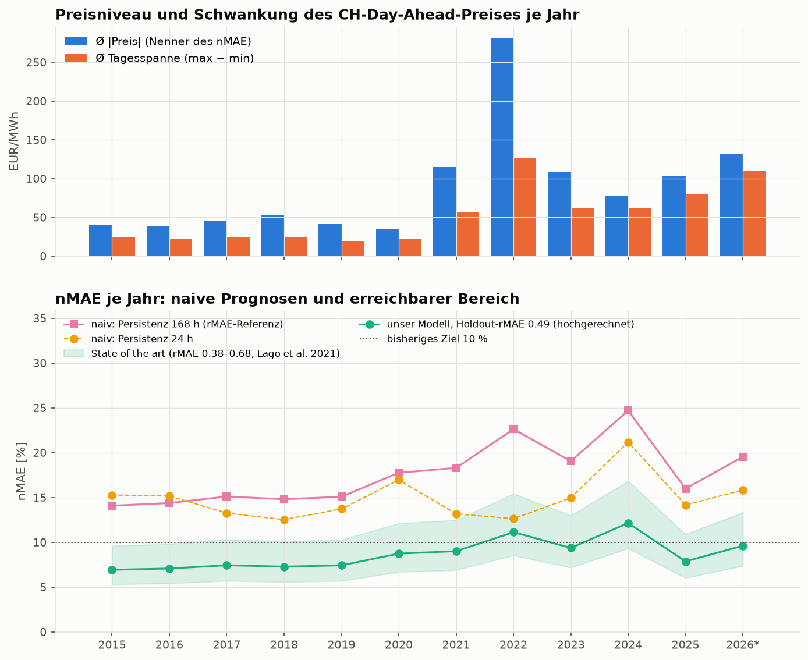
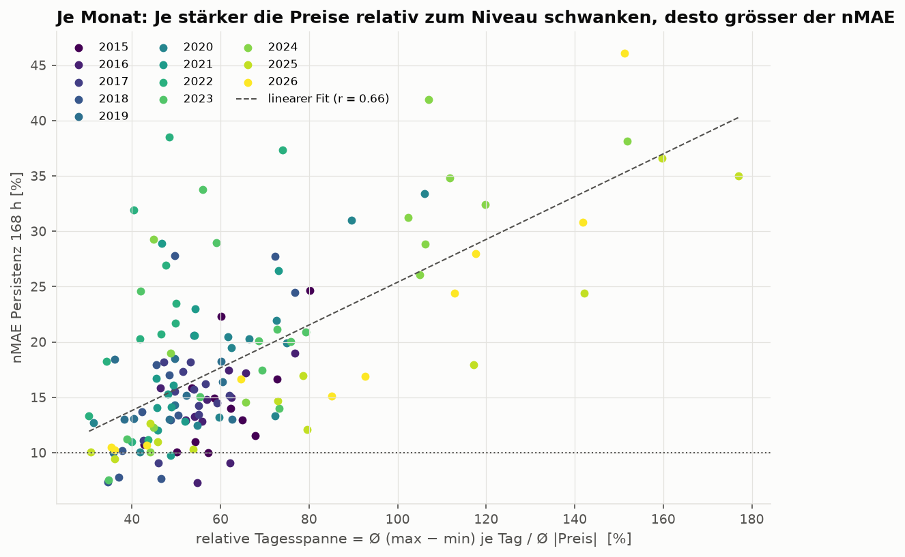
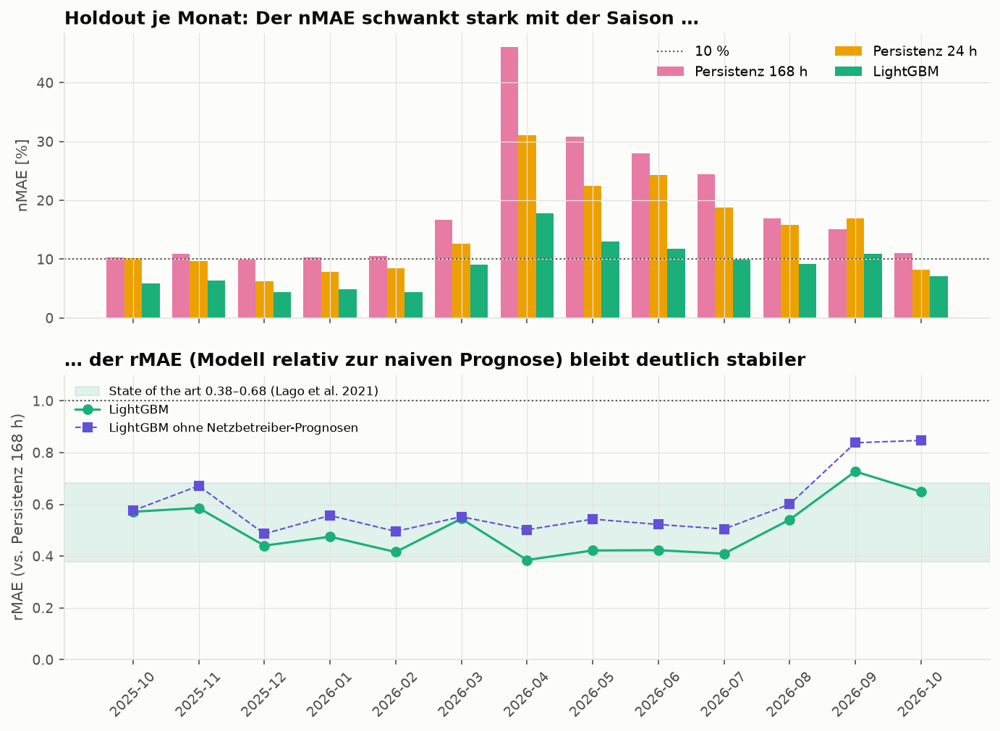

# Zielwert-Analyse: Welcher nMAE ist für die 24h-Prognose sinnvoll?

CH-Day-Ahead (energy-charts), 08.01.2015 – 24.10.2026, 103390 Stunden, stündlich gemittelt. \* = laufendes Jahr (unvollständig).

- nMAE = MAE / Ø |Preis|
- rMAE = MAE_Modell / MAE_naiv mit naiv = Persistenz 168 h (p_d−7,h), Definition nach Lago et al. (2021), Gl. 9

## Niveau, Schwankung und Schwierigkeit je Jahr

|       |   Stunden |   Auflösung_min |   Mittel |   Ø |Preis| |   Std |   Ø Tagesspanne |   rel. Tagesspanne_% |   Std. negativ |   nMAE Persistenz 24 h_% |   nMAE Persistenz 168 h_% |   nMAE Wochen-Naiv_% |   nMAE Profil 14 Tage_% |
|:------|----------:|----------------:|---------:|------------:|------:|----------------:|---------------------:|---------------:|-------------------------:|--------------------------:|---------------------:|------------------------:|
| 2015  |    8591.0 |            60.0 |     40.3 |        40.3 |  13.2 |            24.0 |                 59.4 |            9.0 |                     15.3 |                      14.1 |                 11.1 |                    12.1 |
| 2016  |    8784.0 |            60.0 |     37.9 |        38.0 |  16.8 |            22.1 |                 58.3 |           24.0 |                     15.2 |                      14.4 |                 11.1 |                    12.6 |
| 2017  |    8760.0 |            60.0 |     46.0 |        46.0 |  19.6 |            24.1 |                 52.3 |            5.0 |                     13.3 |                      15.1 |                 11.1 |                    13.9 |
| 2018  |    8760.0 |            60.0 |     52.2 |        52.3 |  16.4 |            24.6 |                 47.1 |           29.0 |                     12.5 |                      14.8 |                 11.3 |                    12.8 |
| 2019  |    8760.0 |            60.0 |     40.9 |        41.0 |  12.3 |            19.8 |                 48.4 |           17.0 |                     13.7 |                      15.1 |                 12.2 |                    13.0 |
| 2020  |    8784.0 |            60.0 |     34.0 |        34.2 |  14.8 |            21.6 |                 63.0 |           75.0 |                     17.0 |                      17.7 |                 14.7 |                    15.8 |
| 2021  |    8760.0 |            60.0 |    114.9 |       115.1 |  83.9 |            56.7 |                 49.3 |           41.0 |                     13.2 |                      18.3 |                 12.8 |                    15.5 |
| 2022  |    8760.0 |            60.0 |    281.7 |       281.7 | 128.2 |           126.4 |                 44.9 |            1.0 |                     12.6 |                      22.6 |                 15.1 |                    20.7 |
| 2023  |    8760.0 |            60.0 |    107.5 |       107.8 |  40.5 |            62.4 |                 57.9 |           76.0 |                     15.0 |                      19.0 |                 15.0 |                    16.6 |
| 2024  |    8784.0 |            60.0 |     76.0 |        77.2 |  39.0 |            61.6 |                 79.8 |          292.0 |                     21.2 |                      24.7 |                 19.6 |                    21.3 |
| 2025  |    8760.0 |            60.0 |    101.7 |       102.8 |  40.8 |            79.4 |                 77.2 |          303.0 |                     14.2 |                      16.0 |                 12.4 |                    13.3 |
| 2026* |    7127.0 |            60.0 |    128.7 |       131.0 |  58.1 |           110.1 |                 84.0 |          239.0 |                     15.8 |                      19.5 |                 15.4 |                    15.8 |

Gesamter Zeitraum: nMAE Persistenz 24 h 14.4 %, Persistenz 168 h 19.1 %, Wochen-Naiv 14.1 %, Profil 14 Tage 16.7 %.

Je Monat korreliert der nMAE der Persistenz 168 h mit der relativen Tagesspanne mit r = 0.66 (Spannweite der Monate: 7.3 – 46.1 %).

## Literatur: rMAE von State-of-the-art-Modellen

Lago, Marcjasz, De Schutter & Weron (2021), Applied Energy 293, 116983, Tab. 2 und 3 (je 2 Jahre Test zwischen 2015 und 2018):

|           |   rMAE min (DNN-Ensemble) |   rMAE max (schwächstes LEAR) |
|:----------|--------------------------:|------------------------------:|
| EPEX-DE   |                     0.377 |                         0.469 |
| Nord Pool |                     0.403 |                         0.482 |
| PJM       |                     0.439 |                         0.550 |
| EPEX-FR   |                     0.533 |                         0.638 |
| EPEX-BE   |                     0.573 |                         0.682 |

## Unser Modell im Holdout: nMAE vs. rMAE

Gesamt: nMAE LightGBM 8.7 %, Persistenz 168 h 17.7 % → **rMAE 0.49** (ohne Netzbetreiber-Prognosen 0.58; relativ zu Persistenz 24 h 0.61).

Streuung je Monat: nMAE LightGBM 4.4 – 17.7 % (Faktor 4.1), rMAE 0.38 – 0.73.

|         |   Stunden |   Ø |Preis| |   nMAE LightGBM_% |   nMAE Persistenz 24 h_% |   nMAE Persistenz 168 h_% |   rMAE LightGBM |   rMAE ohne NB-Prognosen |   LightGBM / Persistenz 24 h |
|:--------|----------:|------------:|------------------:|-------------------------:|--------------------------:|----------------:|-------------------------:|-----------------------------:|
| 2025-10 |    745.00 |      106.25 |              5.89 |                    10.22 |                     10.32 |            0.57 |                     0.58 |                         0.58 |
| 2025-11 |    720.00 |      116.83 |              6.43 |                     9.72 |                     10.97 |            0.59 |                     0.67 |                         0.66 |
| 2025-12 |    744.00 |      114.09 |              4.42 |                     6.19 |                     10.04 |            0.44 |                     0.49 |                         0.71 |
| 2026-01 |    744.00 |      133.23 |              4.87 |                     7.80 |                     10.25 |            0.47 |                     0.56 |                         0.62 |
| 2026-02 |    672.00 |      114.07 |              4.36 |                     8.50 |                     10.49 |            0.42 |                     0.50 |                         0.51 |
| 2026-03 |    743.00 |      133.32 |              9.08 |                    12.68 |                     16.67 |            0.54 |                     0.55 |                         0.72 |
| 2026-04 |    720.00 |       94.59 |             17.74 |                    31.02 |                     46.09 |            0.38 |                     0.50 |                         0.57 |
| 2026-05 |    744.00 |      109.36 |             13.01 |                    22.51 |                     30.84 |            0.42 |                     0.54 |                         0.58 |
| 2026-06 |    720.00 |      104.45 |             11.82 |                    24.30 |                     27.96 |            0.42 |                     0.52 |                         0.49 |
| 2026-07 |    744.00 |      117.06 |             10.00 |                    18.81 |                     24.44 |            0.41 |                     0.50 |                         0.53 |
| 2026-08 |    744.00 |      139.79 |              9.13 |                    15.86 |                     16.89 |            0.54 |                     0.60 |                         0.58 |
| 2026-09 |    720.00 |      168.44 |             10.98 |                    16.96 |                     15.10 |            0.73 |                     0.84 |                         0.65 |
| 2026-10 |    552.00 |      211.00 |              7.14 |                     8.21 |                     11.01 |            0.65 |                     0.85 |                         0.87 |

## Szenarien: erreichbarer nMAE je Jahr bei gegebenem rMAE

nMAE ≈ rMAE × nMAE(Persistenz 168 h) des jeweiligen Jahres.

|         |   naiv (Persistenz 168 h) |   unser Modell (rMAE 0.49) |   rMAE 0.4 |   rMAE 0.5 |   rMAE 0.6 |   rMAE 0.7 |
|:--------|--------------------------:|---------------------------:|-----------:|-----------:|-----------:|-----------:|
| 2015    |                      14.1 |                        6.9 |        5.6 |        7.0 |        8.4 |        9.9 |
| 2016    |                      14.4 |                        7.1 |        5.7 |        7.2 |        8.6 |       10.1 |
| 2017    |                      15.1 |                        7.4 |        6.0 |        7.6 |        9.1 |       10.6 |
| 2018    |                      14.8 |                        7.3 |        5.9 |        7.4 |        8.9 |       10.4 |
| 2019    |                      15.1 |                        7.4 |        6.0 |        7.5 |        9.0 |       10.6 |
| 2020    |                      17.7 |                        8.7 |        7.1 |        8.9 |       10.6 |       12.4 |
| 2021    |                      18.3 |                        9.0 |        7.3 |        9.1 |       11.0 |       12.8 |
| 2022    |                      22.6 |                       11.1 |        9.0 |       11.3 |       13.6 |       15.8 |
| 2023    |                      19.0 |                        9.4 |        7.6 |        9.5 |       11.4 |       13.3 |
| 2024    |                      24.7 |                       12.1 |        9.9 |       12.3 |       14.8 |       17.3 |
| 2025    |                      16.0 |                        7.9 |        6.4 |        8.0 |        9.6 |       11.2 |
| 2026*   |                      19.5 |                        9.6 |        7.8 |        9.8 |       11.7 |       13.7 |
| Ø Jahre |                      17.6 |                        8.7 |        7.0 |        8.8 |       10.6 |       12.3 |
